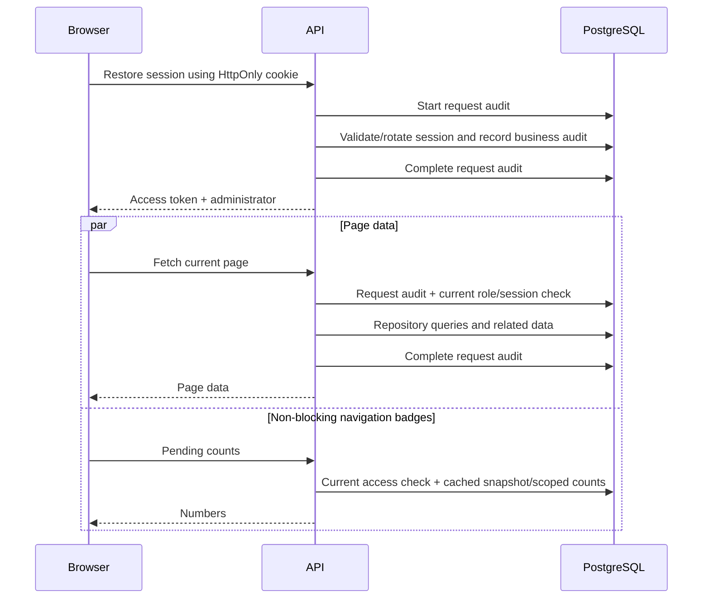

# Why loading is slow, and how to make it faster

29 October 2026 · Admin V1 + API V2 · Findings, measurements and implementation plan

## 1. What matters first

The slow loading is real. It is not mainly a matter of changing spinners, animations or React styling.

The current admin/API flow makes several remote database operations before a page can finish loading. The access directory returned only **3 administrators**, but its repository executed **11 SQL statements**. Admin request auditing and current-session authorization add work around that repository. On a fresh visit, session restoration must finish before page requests even start.

The largest opportunities are:

1. Reduce database round trips per request, particularly the access directory and authentication.
2. Stop repeatedly fetching the same page data and statistics.
3. Reduce the time request auditing adds to the response while preserving reliable audit records.
4. Remove optional location enrichment and attachment downloads from the main loading path.
5. Verify where API/database compute actually run and measure cold versus warm requests separately.
6. Split additional admin routes and improve asset loading after the database path is addressed.

**The recent session fix prevents false logout. Increasing its timeout to 60 seconds does not make a request faster.** It gives a slow request longer to finish. The loading work below is a separate improvement.

This document makes recommendations. No application performance settings, hosting subscriptions, database data or runtime code were changed for this report. Measurement used read-only repository/database queries and three public health requests. No extra environment variables are proposed as a prerequisite for the first implementation phase.

## 2. Measured evidence

### 2.1 Existing successful request records

Read-only aggregation of `admin_activity` covered the two hours preceding measurement on 29 October, around 22:44 IST. Only completed HTTP 2xx requests for the listed paths were included.

| API path | Samples | Mean | Median / p50 | p95 |
| --- | ---: | ---: | ---: | ---: |
| `/admin/access/1more-admin` | 30 | 7.272 s | 6.208 s | 11.957 s |
| `/admin/auth/refresh` | 8 | 7.755 s | 8.801 s | 9.998 s |
| `/admin/vehicle-categories` | 8 | 3.455 s | 3.615 s | 4.586 s |
| `/admin/partner-program/applications` | 4 | 6.731 s | 5.658 s | 9.887 s |
| `/admin/auth/google` | 2 | 11.745 s | 11.745 s | 14.873 s |

These are useful evidence of substantial waiting, with important limits:

- They measure the interval between recorded server start/completion markers, not the full browser experience.
- The completion marker is calculated before its final database audit update finishes. Response serialization, transfer and browser rendering add further time.
- The records do not identify which deployment produced them. This database can be shared by local and deployed API processes; the table is not a Vercel-only benchmark.
- The small samples, especially two Google logins, are not a stable production service-level measurement.
- Google login timing here does not include the browser's location collection before sending the request.

### 2.2 Direct database/repository checks from this workspace

| Read-only operation | Observed duration | Interpretation |
| --- | ---: | --- |
| First `SELECT 1` in a new measurement process | 2.781 s | Includes initial connection establishment and possibly other startup/wakeup costs |
| Next `SELECT 1` | 305 ms | Minimal warm database round trip from this workspace |
| Third `SELECT 1` | 304 ms | Confirms a substantial network/connection baseline |
| Access-directory repository, first sample | 5.789 s | Returned 3 rows; serialized repository result was 2,773 bytes |
| Access-directory repository, second sample | 3.347 s | Same 3 rows and result size |
| Separate warmed SQL trace of the access repository | 5.457 s | 11 statements: BEGIN, SET, 8 SELECTs, COMMIT |

The trace used Prisma query events with only statement verbs and durations retained. No query parameters, user records, credentials or tokens are included here. The trace used a read-only Prisma client with the same datasource configuration; the normal client's extra extension prepares IDs for writes and does not affect these reads.

The repository timing excludes HTTP request auditing, the HTTP authorization guard and browser rendering. The result is small, so response download size cannot explain these repository durations.

**Inference:** repeated remote round trips are a major contributor for the local development path. A 304 ms minimal round trip multiplied across many serial statements can become seconds without a large table. This does not establish how much time each statement spends executing inside PostgreSQL; that needs a query plan and server-side timings.

### 2.3 Small deployed health sample

| Request from this workspace | HTTP status | Total time | Vercel region hint |
| --- | ---: | ---: | --- |
| Direct API health, first request | 200 | 3.424 s | `bom1::iad1` |
| Direct API health, second request | 200 | 666 ms | `bom1::iad1` |
| Health through the admin host's API rewrite | 200 | 470 ms | Header included `bom1` and `iad1` |

The health service actually runs `SELECT 1`; it is not a database-free liveness response. The first slower request is consistent with startup/connection effects but does not prove which component was cold. The later proxy request being faster does not prove the proxy speeds requests up: these are three sequential, non-controlled samples that warmed the system.

The configured database hostname indicates `us-east-2` and uses a pooled endpoint. Response headers suggest the API request passed through Mumbai and an `iad1` execution location. These are routing hints, not a full inspection of hosting dashboards or all deployed functions.

**Do not assume the API is currently executing in India while its database is in America. The observed hints instead place API execution and the database in the eastern US, although in different regions.** Local development still reaches that remote database from the workspace machine.

## 3. Current loading flow

On a fresh authenticated admin visit:

The badge request does not directly gate page rendering, but it competes for API/database capacity. On the Users section, directory and selected-user requests can also run. Increasing concurrency without reducing work can increase pool contention instead of reducing total loading time.

## 4. Findings ranked by impact

| Priority | Finding | Evidence | Main benefit of fixing it |
| --- | --- | --- | --- |
| P0 | Too many database statements for access-directory reads | Warm trace: 11 statements for 3 admins | Less real API latency |
| P0 | Audit writes are awaited on the response path | Request middleware, audit interceptor/service | Less fixed overhead on nearly every admin request |
| P0 | Session restore precedes page loading | AuthProvider and App loading gate | Reduces the fresh-visit waterfall when restore is optimized |
| P0 | No shared query cache for most management resources | `useAdminResource` and feature-specific loading effects | Faster repeat navigation and fewer requests |
| P1 | Optional location work precedes authentication completion | Browser capture, IP fallback, server geolocation | Faster Google sign-in |
| P1 | Unconditional focus reloads and repeated stats | Access page and UsersProvider | Fewer redundant reads and full-page loading states |
| P1 | Cache-hit pending counts still enter a transaction | PendingService | Cheaper recurring badge requests |
| P1 | Private documents travel as base64 JSON; final PDFs may prefetch | Partner asset controller and confirmation review | Faster previews and less memory/transfer |
| P1 | Cleanup/email background work shares the database pool | Retention startup and notification scheduling | Less contention during interactive requests |
| P2 | Most management routes remain eager imports | App route imports and build output | Faster first app boot on slower devices/networks |
| P2 | Remote font CSS is imported from the stylesheet | Global stylesheet | More predictable initial text rendering |

The first four are directly supported by code/measurements. Exact regional penalties, database suspension settings, CPU saturation and production cold-start frequencies still need hosting telemetry.

## 5. API and database improvements

### 5.1 Rewrite the access-directory read path

Relevant files: [access repository](../apps/api/v2/src/features/admin_access/admin_access.repo.ts), [access service](../apps/api/v2/src/features/admin_access/admin_access.service.ts).

Currently a RepeatableRead transaction performs count, paginated users with nested relations, grouped status counts and awaiting-sign-in count. Nested relations add SQL beyond the apparent top-level method calls. This was a fixed group of reads in the observed trace; it is not evidence of one extra query for every individual administrator.

Recommended design:

- Return only fields displayed in the directory.
- Use a combined parameterized read with aggregates and carefully bounded joins/EXISTS expressions, or benchmark Prisma's relation-join strategy.
- Avoid joining two one-to-many collections directly and multiplying rows. Aggregate relation data first or use lateral subqueries.
- Fetch latest login-location information once per returned administrator, with the existing indexed lookup or a deliberately designed projection.
- Derive compatible summary counts in one aggregate rather than separate scans.
- Consider a separately cached global summary: changing page/search should not recalculate all global stats every time.
- Preserve stable ordering, exact page clamping, grant-version semantics, case-insensitive search and current output contracts.
- If multiple reads must reflect one snapshot, keep that guarantee. A single SQL statement can provide one statement-level snapshot without a long interactive transaction.

Target: substantially reduce the current 11 statements; aim for approximately 2–4 for the directory data path if the chosen design permits it, then count authorization/audit overhead separately. This is a design target, not a promised benchmark.

**Do not just wrap the existing transaction's queries in Promise.all.** Prisma documents that queries on one transaction connection still execute serially. Additional independent connections can parallelize genuinely independent reads, but increase connection demand and can change consistency. [Prisma transaction behavior](https://www.prisma.io/docs/orm/v6/prisma-client/queries/transactions).

Prisma V6's `relationLoadStrategy` requires checking the installed feature support and preview configuration; this schema does not currently enable `relationJoins`. A Prisma method with nested includes is not automatically one SQL statement. Benchmark joins versus batched reads before enabling it broadly. [Prisma V6 relation strategies](https://www.prisma.io/docs/orm/v6/prisma-client/queries/relation-queries).

### 5.2 Keep authorization authoritative, but reduce its query cost

Relevant file: [AuthGuard](../apps/api/v2/src/core/guards.ts).

Every protected request checks current user role/status and, for browser tokens, a live session family. That is necessary for immediate deactivation/revocation enforcement.

Improve the shape of this read: select the few required user fields and evaluate live-family existence with one bounded SQL statement where practical. Verify actual SQL before assuming the nested session selection already produces one statement.

Do not remove database checks, trust a cached ADMIN role indefinitely, accept revoked families, or skip ownership checks to make numbers look faster. Do not make protected entity endpoints public. The public fixed-policy audit-cleanup endpoint is a separate user-approved exception.

### 5.3 Optimize audit overhead without losing administrator actions

Relevant files: [request middleware](../apps/api/v2/src/core/request_context.middleware.ts), [audit interceptor](../apps/api/v2/src/core/admin_audit.interceptor.ts), [audit service](../apps/api/v2/src/core/admin_audit.service.ts).

The reliability work adds an awaited request-audit upsert before admin requests proceed and an awaited completion update before successful responses finish. That is a real tradeoff: stronger visibility currently costs latency. The interceptor's later `start` call is deduplicated; do not count it as another unconditional insert.

Recommended sequence:

1. Measure start/complete write times separately from business queries.
2. Keep mutations and their business audit in the same transaction.
3. Reduce request-audit SQL and connection churn; preserve unique request-ID deduplication.
4. Classify high-frequency read telemetry separately from security-sensitive mutation/session events.
5. If moving completion telemetry off the response path, use a durable outbox/queue with retries, failure visibility and deduplication. Specify what happens to denied, malformed, aborted and serialization-failed requests.
6. Keep seven-day retention and the existing accurate outcome semantics.

`waitUntil` is useful for extending background work on Vercel, but it is not a durable queue and does not guarantee eventual persistence after an infrastructure failure. Do not replace reliable audit writes with untracked fire-and-forget promises or console messages. Region/query optimization can reduce audit cost before introducing another service. [Vercel background processing](https://vercel.com/docs/fluid-compute).

### 5.4 Measure connection pools before changing limits

The code already reuses a Prisma client per process and uses the provider's pooled database endpoint. It also supplies connection/pool wait defaults and a smaller default pool per Vercel instance. These improvements are already present, not tasks to implement again.

Next steps:

- Record connection-acquisition time, active connections, waiting requests, transaction duration and P2024 frequency.
- Budget connections across all instances, local watchers, jobs and deployment versions.
- Keep network calls, file conversion, SMTP and HTTP geocoding outside database transactions.
- Prefer short transactions and bounded concurrency.
- Keep the existing acquisition-only retry; do not blindly replay transactions whose writes may have committed.
- Do not set an unlimited pool or dramatically increase connections as a blanket fix.

Longer pool waits reduce some immediate failures but can make users wait longer. Connection pooling does not remove network latency or make expensive SQL cheap. [Neon pooling](https://neon.com/docs/connect/connection-pooling).

### 5.5 Index and query-plan work

Use slow-query traces and `EXPLAIN (ANALYZE, BUFFERS)` on representative read queries in a suitable test environment. ANALYZE executes the statement; do not run it on destructive statements in production.

Candidates to inspect, not blindly add:

- Active session lookup by user, family, revocation and expiry.
- Latest login audit by actor/action/time. Existing actor/time and entity/time indexes may already be sufficient.
- Application and ride status/date/order combinations used by lists.
- JSON expressions on notification kind, application_id and delivery state when plans show expensive scans.
- Case-insensitive substring search. Ordinary B-tree indexes do not generally solve arbitrary contains searches; consider supported PostgreSQL trigram indexes when data volume justifies them.
- Deep offset pagination: add cursor pagination when datasets grow and product navigation permits it.

Do not add every possible index. Each index consumes storage and increases write work. The tiny measured directory shows that query count/network overhead matters even before large-table indexing becomes the main issue.

## 6. Admin data loading and caching

### 6.1 Add one common query cache

Relevant files: [resource hook](../apps/admin/v1/src/lib/useAdminResource.ts), [UsersProvider](../apps/admin/v1/src/modules/users/UsersProvider.tsx), [access page](../apps/admin/v1/src/modules/admin-access/AdminAccessPage.tsx).

The common hook fetches on mount/revision/path changes and keeps data only in the mounted hook. Returning to a route usually repeats the read. Several pages have their own similar effects.

Use TanStack Query or one equivalent shared layer, not a separate caching implementation per feature. TanStack Query is a reasonable choice for this React app because it covers deduplication, query lifetimes, cancellation and invalidation. Its defaults require deliberate tuning: data starts stale and stale queries may refetch on focus; simply installing it will not automatically reduce traffic. [Official query defaults](https://tanstack.com/query/latest/docs/framework/react/guides/important-defaults).

Suggested starting policy, subject to verification:

| Data | In-memory freshness | Refetch/invalidation |
| --- | --- | --- |
| Vehicle categories/brands/models | 2–5 minutes | Invalidate after relevant edits/import/review |
| Requirements and published document metadata | 2–5 minutes | Invalidate after field/category/document changes |
| Admin access directory | 15–30 seconds | Invalidate after access mutations; role checks stay server-side |
| User directory and Personal | 15–30 seconds | Invalidate after edits/deactivation |
| Applications/confirmations/vehicles | 10–15 seconds | Invalidate affected list/detail/counts after review |
| Rides/reports | 5–15 seconds depending on live state | Refresh after actions and when genuinely stale |
| Audit list | 10–15 seconds | Refresh after filters or explicit reload |

Use complete query keys: authenticated identity, route/entity, filters, page, pending-only mode and other relevant scope. Clear private caches on logout/account switch/access rejection. An old administrator's cached results must never appear under a newly signed-in account.

Use bounded in-memory caches first. Do not persist KYC documents, selfies, bank details or private records in localStorage, and do not make authenticated JSON public CDN-cacheable.

### 6.2 Keep useful data visible while refreshing

Show cached/current results immediately and indicate a background refresh instead of clearing the entire directory. Preserve entity identity checks so switching users never briefly shows the previous person's details.

Debounce typed searches, not ordinary initial empty searches or immediate filter changes. The Users directory currently waits 300 ms before even its initial fetch. That is small compared with the multi-second API, but unnecessary once the API is improved.

Retain errors and explicit retry controls. A spinner cannot fix slow SQL, and optimistic presentation must not imply an approval/save was committed before the server confirms it.

### 6.3 Stop unnecessary focus refetches

The access page refreshes whenever the window gains focus. UsersProvider also refreshes on focus. Returning from DevTools, a file picker or another browser tab can trigger another expensive read.

Refetch only when stale, when an important mutation invalidates the data, or when the operator explicitly asks. Keep a sensible focus refresh policy for genuinely live operational pages.

Development StrictMode can run extra effect setup/cleanup cycles. Keep StrictMode and fix request deduplication/cancellation. Do not treat development-only duplicate effects as proof that the production build sends the same duplicate requests.

### 6.4 Avoid list/detail waterfalls and duplicate identity reads

The Users area can fetch the selected user's summary separately from a rides or vehicle response that already includes user information. Reuse a compatible cached identity where possible, while allowing independent detail refresh and validating the selected ID.

Keep list summaries lightweight; load full answers, policy snapshots, history and attachments only when their corresponding detail view needs them. A small bootstrap payload can combine genuinely shared session/shell metadata, but avoid one giant endpoint that loads every module before any page appears.

## 7. Pending badges and background work

The badge system already has useful safeguards: one provider, visible-entity scopes capped at 50, a database snapshot with 30-second freshness, 60-second visible polling, cancellation and no successful-poll request audit writes. Keep those; the plan is not to rebuild it from zero.

Improve further:

- Read a valid snapshot outside an interactive transaction where correctness permits. Keep the existing lock/double-check/invalidation behavior on cache misses.
- Fetch only needed scoped counts and avoid rebuilding the global snapshot for every visible entity change.
- Coalesce scope changes and mutation bursts; never overlap polls.
- Pause inactive/hidden operational views and resume only when necessary.
- Invalidate the affected query/count groups after mutations rather than reloading every module.
- Schedule heavyweight mail retries and retention cleanup away from the first interactive page request where possible.

The current retention service starts background cleanup at API startup. On a cold serverless instance, this can share the small database pool with the first sign-in/read. Prefer the daily cron for backlog cleanup, keep cleanup bounded, and measure whether startup cleanup needs delaying. Preserve the policy that expired audit rows are immediately excluded from list reads.

The cleanup endpoint is public by explicit request. Consider harmless per-instance/global coalescing or nonblocking cleanup admission to limit redundant work without reintroducing a secret requirement or allowing callers to change the seven-day cutoff. The existing advisory lock protects individual batches but is not an HTTP traffic budget.

## 8. Make Google sign-in faster

Relevant files: [browser location capture](../apps/admin/v1/src/modules/auth/login-location.ts), [auth API](../apps/admin/v1/src/modules/auth/auth.api.ts), [admin auth service](../apps/api/v2/src/features/admin_auth/admin_auth.service.ts), [login location lookup](../apps/api/v2/src/infra/security/login_location.ts).

Currently the browser waits for location before sending Google authentication. Its fallback timer can take 10 seconds; an IP fallback may then take another 2.5 seconds. The API verifies Google identity and also awaits reverse/IP geolocation, with a three-second lookup timeout, before creating the session.

These are configured timeout ceilings, not claims that every login pays every ceiling.

Recommended flow:

1. Verify Google identity and enforce approved admin access as usual.
2. Record the observed request IP, consent/permission state and any already available coordinates with the sign-in event.
3. Complete the session without waiting for optional place-name/ISP enrichment.
4. Bind later location metadata to that exact authenticated sign-in/session, then enrich asynchronously with retries and a visible pending/unavailable state.
5. Preserve the location permission request and distinguish approximate IP location from browser GPS. No silent GPS collection or invented location.

A client-reported IP is not authoritative. Keep the current provenance labels and configure proxy trust accurately rather than trusting arbitrary forwarded headers. If a latest-login projection replaces repeated audit joins, define its retention explicitly; do not accidentally preserve seven-day audit location data indefinitely.

Google token verification, signature/audience/expiry checks and account access cannot be deferred. Session restoration should remain a secure cookie operation; do not move refresh tokens into browser storage to avoid a network request.

## 9. Documents, photos, PDFs and form submission

The partner detail response selects attachment metadata, not every file's contents. That is already appropriate. However, an actual private asset request returns database bytes encoded as a base64 data URL inside JSON. Base64 requires roughly four encoded bytes per three binary bytes before JSON/transport compression and decoding costs.

The confirmation review also prepares the final PDF for sharing after loading a completed confirmation, even when the admin has not clicked Share. That can download a full PDF while the operator only wants to read status.

Recommended order:

- Load final PDF bytes only when Preview, Download, Email preparation or Share actually needs them.
- Deduplicate an in-flight preview/share download and reuse its Blob for that review session; release object URLs afterward.
- Offer a protected binary response with correct MIME/content-disposition instead of base64 JSON. Preserve ownership/admin authorization.
- Use small generated thumbnails for selfie/document summaries instead of full images when full resolution is unnecessary.
- If file storage becomes a bottleneck, evaluate private object storage or private/authenticated media storage with short-lived delivery authorization. Do not publish identity documents to a public image CDN.
- Keep images converted to WebP before storage/upload as required. Use appropriate dimensions/quality for their purpose and retain legibility for verification.
- If adding multipart uploads, keep validation, quotas, idempotency and the rule that entity uploads occur on explicit form submission.
- Bound upload concurrency. Sending all KYC documents at once can overwhelm mobile memory, API JSON parsing and database connections.

Storage migration is a later project with access-policy, deletion and migration tests. First remove unnecessary downloads and measure file sizes. Moving metadata to another database is not the first fix.

## 10. Hosting, regions and cold starts

### 10.1 Verify deployment settings before moving anything

The API's checked-in Vercel config does not specify an execution region. The observed health request points to `iad1`; the database hostname points to `us-east-2`. Inspect both dashboards and production timing spans to confirm the actual arrangement.

Keep API compute close to the primary database. For a future India-focused deployment, compare the nearest region supported by both providers and plan moving both parts together. Moving only the API to Mumbai while leaving its database in the US could make serial-query latency worse. A geographic migration needs backups, connection updates, validation and a rollback plan. [Vercel region guidance](https://vercel.com/docs/functions/configuring-functions/region).

Local Flutter/Vite/API development against a distant cloud database can be slow even when a deployed API near the database is much faster. Use a local/test database for daily development where practical, or benchmark development against a suitable test API near the database. Do not copy production KYC or private user data into a developer fixture.

### 10.2 Distinguish connection startup, API initialization and database suspension

The first-request penalties in the sample do not isolate these components. Measure each separately.

- Check whether the current Neon compute actually suspends and which controls are available on the current plan. Do not assume its dashboard setting from the connection string.
- Verify the deployed Vercel project's compute/runtime settings and cold-start telemetry. Fluid compute can reduce startup overhead; it does not make cold starts impossible.
- Review eager imports through AppModule: native image processing, mail and document utilities may not be needed for a directory read. Profile and defer heavy work/imports where safe.
- Keep Prisma reuse inside an instance; do not connect/disconnect it for every API request.
- Avoid aggressive keepalive pings as a supposed free solution. They can consume quotas, incur work and still fail to guarantee warmth.

Neon documents that idle compute can suspend; settings and plan availability must be checked for this project. [Neon scale to zero](https://neon.com/docs/introduction/scale-to-zero).

### 10.3 Free path versus highest predictable performance

| Option | Cost character | What it can improve | Limit |
| --- | --- | --- | --- |
| Reduce SQL, duplicate fetches, blocking enrichment and file downloads | Code work; no new service required | Warm reads, navigation, sign-in and load | Does not guarantee always-warm infrastructure |
| Keep existing provider layout but verify regions/runtime | May fit existing plan | Avoid accidental deployment penalties | Current platform limits still apply |
| Always-active database compute, if offered | Plan-dependent recurring usage | Removes a source of idle database wakeup | Does not eliminate API/network latency |
| Persistent API process near an active database | Hosting/operations cost depends on service | More predictable startup and connection reuse | Requires deployment, monitoring and capacity management |
| Durable queue/cache services | Additional infrastructure, possibly paid | Audit/background throughput or shared cache | Adds operational complexity; use only after measurement |

Start with the code path. No hosting change or paid service is being purchased or enabled by this report. There is no honest guarantee of instant, always-warm requests on an arbitrary free configuration.

## 11. Frontend assets and browser work

The latest existing admin build output records approximately:

| Asset | Minified | Gzip |
| --- | ---: | ---: |
| Main JavaScript chunk | 428.56 kB | 127.90 kB |
| Rich document page chunk | 470.63 kB | 147.60 kB |
| Partner applications chunk | 26.02 kB | 7.69 kB |
| Main CSS | 57.53 kB | 11.85 kB |

These are build estimates, not a captured browser transfer/parse profile. The rich editor is already lazy-loaded; it is not evidence that every login downloads that entire editor chunk.

Next improvements:

- Lazy-load remaining feature pages such as fare policy, access management and large catalogs, preserving useful loading states and error boundaries.
- Prefetch likely next route code on intent/idle, not every route and every record.
- Self-host the existing Space Grotesk font or use a carefully tested font delivery strategy. The current CSS `@import` adds an external dependency; preserve the chosen design and fallback fonts.
- Let hashed assets use long immutable caching; make the HTML update correctly after deployment. Do not apply immutable caching to authenticated API responses.
- Resize avatars/logos for their actual rendered size, preserve circular identities and lazy-load offscreen images.
- Profile expensive rich-text rendering, lists and document previews before adding memoization everywhere.
- Virtualize only genuinely large client-rendered lists; paginated 20-row tables do not need virtualization as a first fix.

Do not rewrite the React app, replace NestJS or upgrade the whole ORM merely because loading is slow. The measurements identify avoidable work in the current stack.

## 12. Flutter rider/driver implications

The reported problem and measurements above concern admin loading. Flutter shares API V2 and benefits from faster API/auth/asset paths, but no device loading profile was collected for this report.

Related source observations and recommendations:

- Dio already has a shared client, refresh coordination and session-version handling. Preserve these instead of introducing one HTTP client per screen.
- Existing debug request/response logging should remain debug-only. Large payload logs can distort development performance; never log document bodies or credentials to diagnose speed.
- The partner and exit pages poll around 20 seconds; driver home polls around 5 seconds. Audit the lifecycle/visibility checks and overlap behavior before increasing polling frequency.
- Separate map-style/tile loading, GPS acquisition, routing-provider latency and app API latency. A slow map tile service is not automatically a slow application database.
- Cache stable catalog/requirements data locally with versions and refresh rules; keep approvals, availability and ride decisions server-authoritative.
- Keep file previews bounded, avoid full-size decode work on the UI thread and reuse already prepared upload data safely.
- Preserve sequential or bounded uploads and idempotent final submission. Do not restore the earlier high-memory form-submit failure while chasing speed.
- Measure on a physical device in profile/release mode. Debug execution, verbose logs and development tooling are not production speed benchmarks. No APK build was needed for this report.

## 13. What to implement first

### Phase 1 — establish a trustworthy baseline

- [ ] Add safe per-request timing spans: request audit start, session guard, pool acquisition, repository, audit completion and response serialization.
- [ ] Count actual SQL statements per endpoint and distinguish query time from connection waiting.
- [ ] Add safe Server-Timing/structured metrics without exposing SQL parameters, tokens, private file data or identity fields.
- [ ] Record cold/warm state, deployment/region and endpoint status alongside latency metrics.
- [ ] Measure production browser navigation with an authorized account; separate Google/location time from API time.

Deliverable: a before/after table based on comparable samples, not a promise based on local mocks.

### Phase 2 — eliminate wasted reads

- [ ] Optimize access-directory SQL and global summaries.
- [ ] Add the common in-memory query cache and request deduplication.
- [ ] Replace unconditional focus reloads with staleness-based refresh.
- [ ] Remove first-load search debounce and duplicate selected-user reads where safe.
- [ ] Keep pending badge reads lightweight and coalesced.

Deliverable: fewer SQL statements per read and fast return navigation, with existing page designs preserved.

### Phase 3 — shorten authentication/audit paths

- [ ] Optimize current-role/live-family checks without weakening them.
- [ ] Remove optional geolocation enrichment from the session response path.
- [ ] Measure and reduce request-audit overhead; retain transactional business audits and reliable request outcomes.
- [ ] Move competing cleanup/mail retry work off interactive startup paths where appropriate.
- [ ] Verify session concurrency and error-recovery regressions again.

Deliverable: faster fresh sign-in/restore with reliable sessions and complete admin-action history.

### Phase 4 — improve bytes and browser startup

- [ ] Defer final-PDF sharing downloads until requested.
- [ ] Introduce protected binary asset delivery and appropriate thumbnails.
- [ ] Lazy-load remaining large routes and improve font/static-asset delivery.
- [ ] Profile real-device rendering before further UI tuning.

### Phase 5 — deployment tuning only if remaining evidence requires it

- [ ] Verify API/database region pairing and compute settings.
- [ ] Evaluate active database/persistent API options against an agreed budget.
- [ ] Plan any region or storage migration separately, including rollback.

This order avoids spending money on infrastructure before removing avoidable SQL/network work.

## 14. Targets and verification

These are proposed engineering targets, not achieved results:

| Metric | Initial target |
| --- | --- |
| Navigation with fresh cached data | Useful content in roughly 100–200 ms on the test device |
| Small warm admin JSON read, production same-region setup | p50 below 500 ms; p95 below 1 s where feasible |
| Session restore, warm path | p95 below 1 s where feasible |
| First authenticated page data | Below 2 s in a defined warm production test |
| Directory repository SQL | Material reduction from 11 statements, with equivalent results |
| Repeated navigation | No redundant request while the relevant cache entry remains fresh |
| Explicit mutation | No double submission; authoritative acknowledgement and targeted refresh |
| Attachments | No full-PDF download merely to show a completed confirmation's status |

Test with at least 30 comparable samples per important warm endpoint and separate cold observations. Include slow mobile/network conditions, shared-cookie multiple tabs and concurrent requests within a safe test workload. Report failures/timeouts as well as successful request percentiles. Never stress the live database casually.

Correctness gates:

- A revoked/deactivated administrator cannot use protected endpoints.
- Role changes and entity review versions remain effective immediately on mutations.
- Private cached records/files do not cross accounts or become public.
- Counts, pagination and list/detail data remain consistent with their documented freshness policy.
- All administrator mutations remain audited; denied/aborted request behavior remains defined and tested.
- File conversion, ownership, MIME checks, quotas and application submission safety remain intact.
- Existing UI components and visual consistency remain unchanged unless a specific loading interaction is deliberately improved.

## 15. Recommended decision

Proceed with **measurement + access-query optimization + one shared client cache first**. In parallel, design optional location enrichment and request-audit completion so they no longer add unnecessary serial delay.

The current evidence does not justify buying a new server, removing audit logs, weakening authentication or rewriting the project. It does justify reducing the number of database trips needed to display a tiny page.
