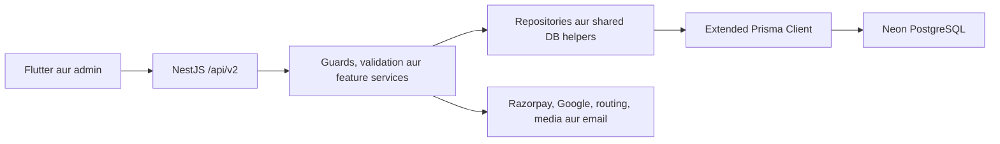

# 1More API v2 · PostgreSQL architecture aur migration report

28 November 2026 · Source `aa98bd2` · NestJS API v2, Flutter aur admin ke shared backend par focus

## Decision

**API v2 ke saare runtime database reads aur writes handwritten PostgreSQL SQL mein convert karna feasible hai.** Aaj bhi database PostgreSQL hai. Proposed change mein SQL Prisma model calls se generate hone ke bajay hum khud own karenge. SQL ownership aur driver replacement do independent decisions hain. Pehle existing Prisma connection aur transactions par explicit SQL use karke behavior aur performance verify karo. Agar end state mein Prisma runtime dependency bhi hatani hai, measured cutover ke baad common `pg` adapter use karo. Migration-only Prisma alag se retain kiya ja sakta hai.

**Raw SQL har query ko faster nahi banata.** Same statement aur comparable parameters par PostgreSQL ko wahi database work plan karna hota hai. Speedup tab expected hai jab rewrite SQL statements aur round trips kam kare, rows kam read kare, payload chhota kare ya better execution plan de. Regular view reusable SQL hai. Materialized view stored snapshot hai jiske saath freshness aur refresh cost ka trade-off aata hai. [PostgreSQL query plans](https://www.postgresql.org/docs/18/using-explain.html) · [Views](https://www.postgresql.org/docs/18/rules-views.html) · [Materialized views](https://www.postgresql.org/docs/18/rules-materializedviews.html)

## Abhi ka architecture

- **HTTP surface.** Route manifest mein 228 entries hain. GET 92, POST 87, PATCH 29, DELETE 15 aur PUT 5. Ek request mein guards, session ya audit ke apne DB calls bhi ho sakte hain. Kuch routes provider-only hain. Conversion inventory ko route handler ke saath cross-cutting reads/writes bhi cover karne honge. [Route manifest](../apps/api/v2/route-manifest.json) · [Nest bootstrap](../apps/api/v2/src/bootstrap.ts)
- **Runtime connection.** Nest ek module-level extended Prisma Client share karta hai. Hosted runtime pooled `DB_STRING` use karta hai. URL mein explicit override na ho toh Vercel par five connections per instance, 15-second connect timeout aur 30-second pool wait configured hain. CLI migrations `DB_DIRECT_STRING` prefer karti hain. Vercel build client generate aur API compile karta hai. Schema deployment separate hai. [Database client](../apps/api/v2/src/infra/database/client.ts) · [Pool configuration](../apps/api/v2/src/infra/database/connection_url.ts) · [Prisma configuration](../apps/api/v2/prisma.config.ts) · [Vercel deployment](VERCEL_DEPLOYMENT.md) · [Neon pooling](https://neon.com/docs/connect/connection-pooling)
- **Query inventory.** TypeScript AST scan ne `src` mein tests, generated files aur scripts exclude karke schema model delegates par **449 direct ORM read** aur **310 direct ORM write call sites** count kiye. Idempotency ke aliased delegate par 6 calls alag mile. **140 raw call sites** hain, jismein 20 `$queryRaw` aur 120 `$executeRaw` hain. 121 direct `$transaction` call sites mile. Ye static locations hain. Loops, nested ORM operations, transaction statements aur aliases ki wajah se isse runtime traffic share ya exact rewrite count infer mat karo. [Schema](../apps/api/v2/prisma/schema.prisma) · [Idempotency interceptor](../apps/api/v2/src/core/idempotency.interceptor.ts)
- **Already handwritten.** Wallet payout preview, cycle lines aur totals raw SQL use karte hain. Auth aur admin account operations advisory locks use karte hain. Audit cleanup bounded `DELETE` aur `SKIP LOCKED` use karta hai. Isliye raw call count ka bada hissa synchronization bhi cover karta hai. [Wallet repository](../apps/api/v2/src/features/wallet/wallet.repo.ts) · [Auth repository](../apps/api/v2/src/features/auth/auth.repo.ts) · [Audit cleanup](../apps/api/v2/src/core/audit_retention.service.ts)
- **Live catalog snapshot.** Configured `lif_test` database ke read-only probe mein PostgreSQL **18.7**, **33 applied migrations**, `public` mein **0 regular views**, **0 materialized views** aur `pg_stat_statements` extension absent mila. Source schema mein 61 models hain. Ye probe isi configured database aur schema tak limited hai.

## Runtime evidence

Ek read-only A/B probe mein latest 20 ride IDs ke liye Prisma `findMany` aur handwritten `$queryRaw` ne same rows aur byte-for-byte same SQL diya. Query `created_at DESC, id DESC` order aur limit 20, offset 0 use karti hai. Dono arms same pooled URL, same process, one warmed app-side connection aur same pagination parameters par alternated hue. 20 samples per arm liye. Timing database client call tak limited thi.

| Same ride projection | Client p50 | Client p95 |
| --- | ---: | ---: |
| Prisma model read | 282.9 ms | 287.4 ms |
| Handwritten SQL via Prisma | 281.5 ms | 283.2 ms |

Separate `EXPLAIN (ANALYZE, BUFFERS)` sample mein DB planning **0.070 ms** aur execution **0.084 ms** tha. Is workstation-to-Neon sample mein client-to-database path SQL execution se kaafi bada tha. Ye one-query microbenchmark local network, pool aur client overhead include karta hai. Isse production p95, direct `pg` speedup, ya complex queries ki improvement establish nahi hoti. Earlier admin audit mein ek directory repository call par **11 SQL statements** trace hue the. Aise endpoints query consolidation benchmark karne ke better candidates hain. [Existing performance audit](LOADING_PERFORMANCE_AUDIT_AND_PLAN.md) · [Existing pool incident investigation](DATABASE_POOL_AUTH_FIX.md) · [PostgreSQL EXPLAIN](https://www.postgresql.org/docs/18/using-explain.html)

## Target design aur kya SQL mein jayega

Nest controllers, DTOs, HTTP envelopes aur guards retain karo. Feature repositories parameterized SQL aur typed result mapping own karein. Shared DB adapter pool acquisition, transactions, cancellation/timeouts aur error mapping own kare. SQL values bind karo aur dynamic sort/filter identifiers predefined allowlist se choose karo. Endpoint ko network provider chahiye toh service usko call kare aur result/claim SQL transaction se persist kare. Razorpay checkout, Google token verification, routing, media conversion aur email orchestration Nest side par rahe. [Prisma parameterized SQL](https://www.prisma.io/docs/orm/v6/prisma-client/using-raw-sql/raw-queries) · [node-postgres queries](https://node-postgres.com/features/queries)

| Operation | PostgreSQL implementation | 1More mein dhyan dena hai |
| --- | --- | --- |
| GET detail, lists, counts | Parameterized `SELECT`, JOIN, `EXISTS`, bounded pagination, aggregates | Owner/role scope, deterministic sorting, selected fields aur matching count filters |
| POST create, upsert, reserve | `INSERT … RETURNING`, `ON CONFLICT`, explicit transaction where needed | ID generation, duplicate requests, same-transaction audit aur related state |
| PUT/PATCH | Conditional `UPDATE … WHERE … RETURNING` | Ownership, valid transition, expected revision, partial vs replacement semantics |
| DELETE | Lifecycle `UPDATE` ya authorized hard `DELETE` | User deactivate, history retain. Partner deletion aur audit cleanup ka existing narrow scope |
| Jobs, wallet, payouts | Set-based SQL, guarded updates, row/advisory locks | Same lock ordering, payout cutoff, immutable ledger, idempotency, provider reconciliation |

Library removal ke bina bhi **runtime CRUD 100% handwritten** ho sakta hai via `$queryRaw`/`$executeRaw`. TypedSQL stable shapes ke liye option hai, lekin Prisma v6 generation step database connection use karta hai. Vercel build ka DB-independent contract bachane ke liye generation isolated CI mein evaluate karo ya runtime-validated SQL row mapping use karo. Agar Prisma runtime completely remove karna hai, existing `Prisma.Decimal`, enums, generated row types, error handling aur helper imports ko explicit replacements chahiye. `pg` transaction mein saare statements ek checked-out client par chalenge. Migration tooling change karna separate rollout hai. [Prisma v6 TypedSQL](https://www.prisma.io/docs/orm/v6/prisma-client/using-raw-sql/typedsql) · [node-postgres transactions](https://node-postgres.com/features/transactions)

### View kab lagani hai

| Pattern | Use |
| --- | --- |
| Direct SQL | Account-specific live balances, ride status, ownership checks, writes aur narrowly indexed lookups |
| Regular view | Driver/ride reporting projection ya repeated join ko ek schema-versioned reusable relation banana. Caller-side account scope enforce karo. View ka execution plan inspect karo |
| Materialized view | Historical admin summaries jahan freshness target defined ho. Snapshot-as-of timestamp aur refresh monitoring rakho. Concurrent refresh ke liye qualifying unique index chahiye |
| SQL function | Stable database-only calculation ya atomic multi-step operation ka consistent reuse, jab multiple real callers aur clear ownership ho |

Live wallet, auth aur trip lifecycle ko current transactional rows chahiye. Snapshot initially historical analytics tak rakho. Agar refresh introduce hota hai toh usko existing single 05:00 IST dispatcher mein register karo, separate Vercel cron entry add na karo. [Refresh rules](https://www.postgresql.org/docs/18/sql-refreshmaterializedview.html) · [Daily cron plan](DAILY_CRON_PLAN.md)

## Migration sequence aur acceptance

1. **Baseline.** Auth refresh, admin access list, ride history, travel context aur wallet/payout preview instrument karo. Endpoint latency, DB acquisition, statement count, DB execution, payload bytes aur failures alag record karo. `pg_stat_statements` supported isolated environment mein enable karke normalization aur total execution time dekho. Representative data, same hosting region/config, warm aur cold runs, concurrent traffic aur p50/p95/p99 use karo. `EXPLAIN ANALYZE` read probes par ya isolated write fixtures par run karo. [PostgreSQL statistics](https://www.postgresql.org/docs/18/pgstatstatements.html) · [PostgreSQL EXPLAIN](https://www.postgresql.org/docs/18/using-explain.html)
2. **Read pilot.** Admin access list aur ride history/travel context mein round trips target karo. Existing and SQL paths ko same fixtures, pagination, empty cases, exact response body aur role scope par compare karo. Read side canary rollback ka easiest candidate hai.
3. **Standard writes.** Catalog aur Saved Places se start karo. Raw write ko Prisma extension ka ID preparation aur ORM-level `@updatedAt` behavior explicitly preserve karna hoga. Defaults, nested writes, decimal/integer paise, opaque string IDs, nullable values aur PostgreSQL error-to-API mapping verify karo. [ID preparation](../apps/api/v2/src/infra/database/entity_id.ts) · [Prisma field semantics](https://www.prisma.io/docs/orm/v6/reference/prisma-schema-reference)
4. **Critical writes.** Auth/session, ride assignment, partner and vehicle review, wallet/commission, payout aur webhooks feature-by-feature migrate karo. Lock ordering, transaction isolation aur audit atomicity preserve karo. Parallel tests mein double confirm, duplicate webhook, insufficient balance, rollback, expired session aur ambiguous commit cover karo. Canary mein ek request ke writes ek implementation se chalein. [Transaction retry helper](../apps/api/v2/src/infra/database/transaction_retry.ts) · [PostgreSQL isolation](https://www.postgresql.org/docs/18/transaction-iso.html)
5. **Optional driver cutover.** Equivalent SQL ko Prisma transport aur `pg` pool ke through back-to-back benchmark karo. Pool limits, acquire/deadline behavior, SQLSTATE mapping, decimal/BigInt/timezone/JSON decoding aur rollback verify karo. Complete hone par dependency scan se ensure karo ki runtime Prisma model calls, client imports aur generated type dependencies zero hain. Existing data, migration chain aur API route contracts validate karo.

**Effort signal.** Read-only pilot contained hai. Full rewrite cross-cutting backend migration hai, with 765 observed ORM call sites including the known idempotency aliases, 121 transaction call sites, migrations aur shared guards/helpers. Wallet aur partner program sabse bade visible clusters hain. Endpoint staging measurements aur parity test results ke baad hi speedup ya delivery estimate commit karna meaningful hoga. Is audit mein code, schema aur infrastructure settings par koi write run nahi hua.
