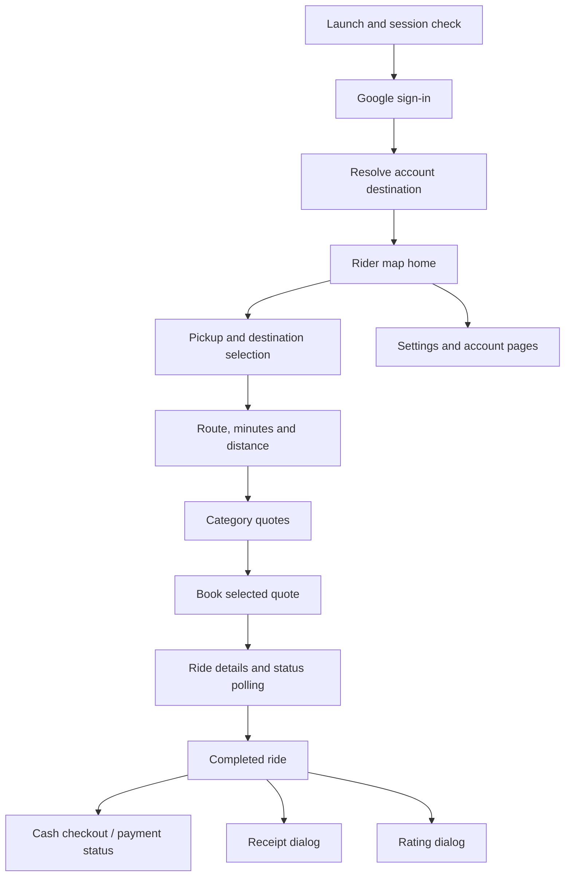
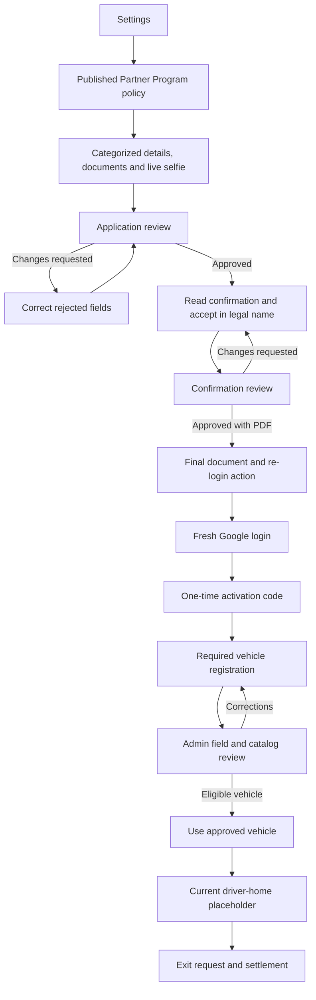

# 1More: rider and driver screen catalog

**Working discussion document — 24 October 2026**

**Source baseline:** commit `19e3e24`, with the current workspace inspected for this document.

**Mobile codebase:** `apps/user/v1`. **Backend reference:** `apps/api/v2`.

**Fare ownership correction - 25 October 2026:** every vehicle category and subcategory now owns its independent distance-band rates. Physical families are compatibility labels and do not select prices; parents do not supply inherited prices. Admin's category editor and Fare Policy page edit the same data. Quotes snapshot category identity/update time and its rates; unconfigured choices receive no fresh quotes. See [category fare implementation](CATEGORY_FARE_POLICY_IMPLEMENTATION.md) for migration, lifecycle, API and verification details. This supersedes former group-based pricing descriptions.

**Combined Phases A-D audit - 25 October 2026:** see [PHASE_ABCD_AUDIT.md](PHASE_ABCD_AUDIT.md) for cross-phase verification and fixes to driver navigation transitions, tracking restart/cancellation, trip snapshot validation, lost-response recovery and transaction-level account checks in older driver writes. This supplements the implementation overlays and individual audit reports below.

This document describes the screens, forms, dialogs, background behavior, and transitions that exist today, then specifies the screens and improvements proposed next. It is a product and implementation discussion document; proposed screens are not an approved final visual design.

**Decision and implementation update — 24 October 2026:** the user answered the discussion questions and supplied a one-page fare-policy PDF, followed by cash/direct-UPI, zero-commission and cancellation/no-show rules. The accepted decisions, exact distance-band formula, completed Phase A checklist, rollout requirements and Phase B contracts are tracked in [PHASE_A_IMPLEMENTATION.md](PHASE_A_IMPLEMENTATION.md). Those decisions supersede earlier alternatives below. During an active trip, offers are view-only; queuing is deferred. No masked-calling provider is selected. Map-first driver operations, combined trip-start verification and in-app navigation are now implemented in Phase B; see the current overlay and tracker below.

**Phase A now implemented:** rider/driver preference and switching, active-trip startup restoration, owner-scoped driver history/recovery pages, versioned fare configuration and quote snapshots, Support contact configuration/mobile actions, refresh callback fixes, notification navigation and Bhagalpur map fallback. Sample driver/OTP UI and the cosmetic scheduling selector were removed. Detailed baseline descriptions below remain useful for the original screen audit; this update and the Phase A tracker take precedence wherever they describe a changed behavior. Phase B below supersedes the original driver-home placeholder. Automated fee collection remains outside this release.

### At a glance

| Area | Current position | Next discussion |
| --- | --- | --- |
| Navigation | 23 registered routes, plus sheets/dialogs and state-based views; active-trip startup restoration, selected-mode entry and trip chat | Device acceptance and external deep links |
| Rider | Booking review, matching/live trip, collection/receipt, history/recovery and minimum safety connected | 12 proposed screen groups/upgrades in section 11 |
| Partner onboarding | Policy, dynamic application, selfie, review, confirmation, final PDF and activation | Correct configuration mismatches and clarify reviewed-data ownership |
| Driver | Vehicle gates, map home, offers, active trips, collection, history and exit are connected | 20 proposed screen groups/upgrades in section 12 |
| Shared account/help | Profile, settings, in-app notices, contacts and basic support exist | 8 proposed screen groups/upgrades in section 10 |

The 40 proposed groups include improvements to existing pages and states that can share a route. They do not imply 40 additional top-level pages. The suggested first build is the paired rider/driver trip cycle, starting with the driver's readiness, online status and incoming offers.

## Contents

1. [How to read this document](#1-how-to-read-this-document)
2. [What the two experiences are today](#2-what-the-two-experiences-are-today)
3. [Current navigation and complete route inventory](#3-current-navigation-and-complete-route-inventory)
4. [Current shared screens](#4-current-shared-screens)
5. [Current rider screens and booking surfaces](#5-current-rider-screens-and-booking-surfaces)
6. [Current Partner Program screens](#6-current-partner-program-screens)
7. [Current driver and vehicle screens](#7-current-driver-and-vehicle-screens)
8. [Actual application fields configured today](#8-actual-application-fields-configured-today)
9. [Current gaps that affect the next screens](#9-current-gaps-that-affect-the-next-screens)
10. [Proposed shared screens and improvements](#10-proposed-shared-screens-and-improvements)
11. [Proposed rider screens](#11-proposed-rider-screens)
12. [Proposed driver screens](#12-proposed-driver-screens)
13. [State, API, and admin dependencies](#13-state-api-and-admin-dependencies)
14. [UI and behavior rules across every screen](#14-ui-and-behavior-rules-across-every-screen)
15. [Implementation phases and completion criteria](#15-implementation-phases-and-completion-criteria)
16. [Decisions for our discussion](#16-decisions-for-our-discussion)
17. [Source references](#17-source-references)

---

## 1. How to read this document

### Status labels

| Label | Meaning |
| --- | --- |
| **CURRENT — CONNECTED** | A reachable screen or surface exists and calls API methods. This does not mean every device, error, or business edge case has been verified. |
| **CURRENT — PARTIAL** | Real UI and some connected behavior exist, with specific missing behavior described below. |
| **CURRENT — PLACEHOLDER** | A visible screen exists but the intended operational product experience is not implemented. |
| **LEGACY / UNREACHABLE** | Source exists but it is not part of the normal current navigation. |
| **PROPOSED — CORE** | Needed to complete the immediate rider/driver journey being discussed. |
| **PROPOSED — LATER** | A potential extension requiring a separate business/product decision. |

### Scope and evidence

- Current descriptions come from the registered Flutter routes, reachable widgets, repositories, API V2 controllers/services, Prisma schema, and existing implementation plans.
- The configuration snapshot in section 8 was read from the database configured for the local API V2 workspace. Only requirement definitions, document publication metadata, and vehicle categories were queried. It is not a dump of users, applicants, documents, or bank details.
- That configuration snapshot can differ from another deployment and can change in admin. Existing submitted applications can retain earlier snapshotted definitions.
- No mobile app was launched, no screenshots were used as verification, and no tests or builds were run for this documentation task. UI descriptions are source-based.
- A “screen” here can be a named page, an anonymous route, a modal, or a substantial state of an existing page. Creating a separate Dart page for every state is not required.
- Suggested fields such as driver net earnings, payout status, waiting charges, and service-area eligibility require authoritative server data; they are not values the mobile app should invent.
- A proposal is explicitly identified even when a database enum or an API endpoint already exists for part of it.

### Priority labels for proposed work

- **P0:** Fix an existing contract or navigation gap that can make the core journey misleading or unusable.
- **P1:** Complete the first functional rider/driver trip cycle.
- **P2:** Complete operations, financial visibility, support, and document maintenance.
- **P3:** Optional growth and convenience features after the core flow is reliable.

---

## 2. What the two experiences are today

### One application, two role-based experiences

There is currently one Flutter project in `apps/user/v1`. The driver experience is inside this project. A separate `apps/driver` application is not currently registered by this implementation.

- Riders sign in, select pickup/drop-off, obtain category quotes, request rides, and open rider ride details.
- Applicants use Partner Program to submit details, documents, and a live selfie, accept an admin-authored confirmation, receive a final PDF, and complete one-time activation.
- Activated drivers encounter mandatory vehicle verification before normal driver home.
- Driver home now provides the Phase B map, readiness and offer console, plus Settings, My vehicles, Trip history and Exit Request & Dues.
- ADMIN/SUPPORT accounts can also have activated partner participation. Their staff role can be preserved while partner status determines entry to the driver experience.
- “User” in the admin directory generally means the personal account; “Driver” classification also considers partner activation. It should not be confused with a second unrelated identity.

### Current rider journey

Session restoration can enter Home without another Google sign-in. Search, route preview, and quotes are states of Home; they are not three separately registered routes.

### Current applicant-to-driver journey

### Important boundaries

1. Approving an application does not approve its confirmation.
2. Approving a confirmation releases the final PDF; it does not skip activation.
3. Correct activation does not verify a newly registered vehicle.
4. A REQUESTED brand/model can be referenced in a driver's submission, but it must be verified before final vehicle approval.
5. A vehicle becoming ACTIVE does not itself mean the driver has gone AVAILABLE to receive offers.
6. Cash checkout being PENDING is not evidence that cash was collected.
7. Completing a partner exit disables driver operations while retaining account/history/document access.

---

## 3. Current navigation and complete route inventory

### 3.1 Registered named routes: 21

| Route | Page | Current purpose | Audience |
| --- | --- | --- | --- |
| `/` | `SessionGate` | Restore session and resolve destination | Shared |
| `/login` | `LoginPage` | Google sign-in landing page | Signed-out |
| `/home` | `HomePage` | Rider map, search, route and quotes | Rider |
| `/settings` | `SettingsPage` | Profile card and account/navigation tiles | Shared |
| `/profile` | `ProfilePage` | Personal account details | Shared |
| `/rides` | `RidesPage` | Rider ride history | Rider; also reachable through shared Settings |
| `/ride-detail` | `RideDetailPage` | Rider ride details; receives a ride ID argument | Rider |
| `/saved-places` | `SavedPlacesPage` | Shared place map, bookmarks, visits, photos and reviews | Shared, both modes |
| `/notifications` | `NotificationsPage` | In-app notification list | Shared |
| `/payment-methods` | `PaymentMethodsPage` | Saved methods and cash setup | Shared, rider-oriented |
| `/emergency-contacts` | `EmergencyContactsPage` | Emergency contact CRUD | Shared |
| `/support` | `SupportPage` | Support ticket list and new-request dialog | Shared |
| `/support-ticket` | `SupportTicketPage` | Ticket conversation; receives a ticket ID argument | Shared |
| `/partner-program` | `PartnerProgramPage` | Policy/application/confirmation/final-state views | Applicant/partner |
| `/partner-program/activation` | `PartnerActivationPage` | One-time driver activation | Approved applicant |
| `/driver/home` | `DriverHomePage` | Vehicle eligibility gate, then current driver home | Activated driver/partner |
| `/driver/vehicles` | `DriverVehiclesPage` | Vehicle submissions, review feedback and selection | Driver |
| `/driver/account` | `DriverAccountPage` | Reviewed account, documents, catalog requests and safety/help | Driver/exited partner |
| `/driver/finances` | `DriverFinancesPage` | Dated earnings and direct-collection transaction statement | Driver/exited partner |
| `/driver/exit` | `DriverExitPage` | Exit request, dues, settlement PDF | Driver/exited partner |
| `/driver/rides` | `DriverTripsPage` | Paginated driver-owned history | Driver/exited partner |
| `/driver/ride-detail` | `DriverTripPage` | Operational map, trip actions, navigation and collection; history remains readable after exit | Driver/exited partner |
| `/trip-chat` | `TripChatPage` | Participant-only text conversation; writes during an active trip | Assigned rider/driver |

**Routing limitation:** named-route registration is not a universal authorization guard. Startup resolution and the driver vehicle gate choose the normal destination; APIs still enforce permissions. Role-aware deep links and resume routing need a complete design.

### 3.2 Reachable surfaces without their own named route

- Home pickup/destination search and search-result list.
- Home map pin selection and route preview.
- Home category quote carousel and booking action.
- Ride cancellation confirmation, rider-start confirmation, payment selector, receipt, and rating dialogs.
- Saved-place create/edit dialog.
- Emergency-contact create/edit dialog.
- Support new-request dialog.
- Partner policy/application/review/confirmation/final PDF states within `/partner-program`.
- Partner date picker, address selections, file picker, native camera, and discard-changes dialog.
- Required inline vehicle registration when no vehicles exist.
- Anonymous vehicle registration/correction page when adding/editing from the vehicle list.
- Brand selector, model selector, brand suggestion form, model suggestion form.
- Vehicle photo-source sheet and private image preview dialog.
- Native file viewer opened for downloaded partner PDFs/documents.

### 3.3 Source that must not be counted as finished screens

- `AppRoutes.search` (`/search`) and `AppRoutes.ride` (`/ride`) are constants without builders in the current route map.
- `features/drawer/pages/drawer_page.dart` remains in source. The Home profile avatar opens Settings instead of the drawer.
- `features/auth/_data_dummy/login_page.dart` is not the registered login page.
- Phase A removed the unreachable sample “driver found” card and sample OTP. The remaining dead styling flag was removed in the follow-up audit. A connected assignment screen remains Phase B work.
- Repository methods for the older vehicle creation/category flow remain, but the current vehicle UI uses the newer verification repository.
- A database enum such as `PUSH`, `WALLET`, or `AUTHORIZED` does not mean its complete mobile experience exists.

---

## 4. Current shared screens

### S01 — Launch, session restoration and destination gate

**Status:** CURRENT — CONNECTED. **Route:** `/`.

**What is shown**

- A small green loading indicator on a white background while session/account resolution runs.
- A recoverable error view with a retry action if a session exists but the current-user request fails.
- No dedicated multi-step onboarding carousel, service-area selection, or first-profile-completion screen.

**What happens**

1. Startup loads the local environment and initializes Firebase before `runApp`.
2. The app checks secure session storage.
3. Without a session it opens Login.
4. With a session it fetches the current account.
5. Role DRIVER, partner status ACTIVATED, or partner status EXITED routes to driver home.
6. Otherwise, activation-required accounts route to Activation; remaining accounts route to rider Home.
7. Driver home then runs the separate vehicle eligibility gate.

**Data and behavior:** auth current-user response, role, partner status, activation-required flag, secure access/refresh session. Session expiry and refresh are handled centrally by Dio.

**Next:** resume an active trip before allowing a new booking or ordinary driver home; explicit suspended/deactivated states; route/deep-link authorization; consistent offline retry. See section 9 for an existing retry-callback risk.

**Source:** [session gate](../apps/user/v1/lib/features/auth/pages/session_gate.dart), [startup](../apps/user/v1/lib/main.dart), [network client](../apps/user/v1/lib/core/network/dio_client.dart).

### S02 — Google login / welcome

**Status:** CURRENT — CONNECTED. **Route:** `/login`.

**What is shown**

- Full-screen tennis/sports background asset with a dark gradient.
- 1More logo at the upper left and a “Sign in” text action at the upper right.
- Decorative overlapping avatar circles and “FIND YOUR NEXT RIDE”.
- “RIDE / BEYOND / THE ROUTE” headline and booking/tracking subtitle.
- A single static page-indicator pill.
- White “Continue with Google” button and progress indicator during sign-in.

**Actions and processing**

- Both the top Sign in action and Google button start the same Google flow.
- Google credentials are exchanged with `/auth/google`; session tokens are stored securely.
- Successful sign-in clears the navigation stack and re-enters the session gate.
- The backend resolves/creates the personal account and determines partner activation state.
- Sign-in errors appear as a snackbar, and the user can retry.
- Repeated taps are guarded while sign-in is in progress.

**Not currently offered:** phone OTP login, Apple sign-in, email/password signup, guest booking, or a role-selection switch. The copy constant for terms is not itself a working legal-links screen.

**Next:** decide transport-specific login art/copy, legal links, supported sign-in methods, consent, and profile/contact completion.

**Source:** [login page](../apps/user/v1/lib/features/auth/pages/login_page.dart), [login copy](../apps/user/v1/lib/features/auth/constants/user.constant.dart), [auth repository](../apps/user/v1/lib/features/auth/auth.repo.dart).

### S03 — Settings and account navigation

**Status:** CURRENT — CONNECTED, with a rider-oriented shared menu. **Route:** `/settings`.

**What is shown**

| Section | Contents and destination |
| --- | --- |
| Profile header | Centered current avatar/fallback, name and email; camera action previews a replacement locally and uploads only after Save |
| Primary cards | Personal Information, Documents, Saved Vehicles, Payment Methods, Settings |
| Settings sheet / top gear | Partner Program; rider/driver switch and driver account where eligible; mode-specific history; saved places; notifications; emergency contacts; support; confirmed Log out; supporting account ID |
| Navigation | Back and the Settings gear/action sheet; no bottom navigation. Existing session/trip and onboarding gates remain authoritative. |

**Behavior:** a matching avatar/header/five-row skeleton appears until the profile and account-scoped mode resolve. Returning from account subpages refreshes the summary; failed refreshes retain loaded data. Logout opens a confirmation dialog, clears the session through the auth repository, and returns to Login. Document and vehicle shortcuts distinguish riders, activated drivers and exited partners. See [the profile redesign](SETTINGS_PROFILE_REDESIGN.md) for the reference, retained actions, photo API and verification.

**Current limitations:** no language/theme controls, permissions dashboard, account-deletion request or dedicated legal/about pages. Rider/driver switching and role-appropriate history are available in the Settings sheet. Driver payout banking remains separate from Payment Methods.

**Next:** dedicated legal, privacy and permission-management screens remain future work. Keep Help and the existing account actions reachable when vehicle verification blocks driving.

**Source:** [settings](../apps/user/v1/lib/features/settings/pages/settings_page.dart).

### S04 — Personal profile

**Status:** CURRENT — CONNECTED. **Route:** `/profile`.

**Visible fields and controls**

| Item | Current behavior |
| --- | --- |
| Avatar | Current server/Google image or person fallback; display only |
| First name | Editable text |
| Last name | Editable text |
| Email address | Displayed in a disabled field |
| Phone number | Editable phone keyboard, international-format example |
| Save changes | Sends names and a non-empty phone value to `PATCH /me` |

**States:** initial loading, load error/retry, saving, success snackbar, API error snackbar. Controllers are populated once for the current page instance.

**Gaps:** no avatar upload here, no phone ownership verification, no password management, and no self-service editing of verified KYC data. Emptying the phone currently omits it from the update payload instead of explicitly removing it. Plain profile fields do not provide the richer form validation used by partner onboarding.

**Next:** identity/contact completion, explicit edit permissions, verified-phone display, safe avatar upload, and clear distinction between profile information and approved application information.

**Source:** [profile](../apps/user/v1/lib/features/profile/pages/profile_page.dart).

### S05 — In-app notifications

**Status:** CURRENT — CONNECTED. **Route:** `/notifications`.

**What is shown:** a glass unread summary, All/Unread filters and compact cards with type icon/label, title, body, local time and unread styling. Type styling covers ride, account, payment, safety, promotion and system notices.

**Actions:** fetch `/me/notifications`, pull to refresh, tap an unread item to persist its `/read` action, then open a connected ride, driver-account or support-request target when that target exists. Empty/filter-empty states are distinct; refresh keeps the loaded inbox visible.

**Gaps:** not every notification data shape has a destination. There is no notification-detail page, preference center, mark-all-read control, or connected mobile push-registration/background delivery flow. Firebase initialization alone does not implement push notifications. The Home bell opens this inbox.

**Next:** notification targets, delivery channels, event deduplication, foreground/background behavior and preferences. Keep the existing list rather than creating a second unrelated inbox.

**Source:** [notifications](../apps/user/v1/lib/features/notifications/pages/notifications_page.dart).

### S06 — Emergency contacts

**Status:** CURRENT — CONNECTED. **Route:** `/emergency-contacts`.

**List UI:** safety-purpose intro, contact count and glass identity cards with initials, international phone number and relationship. Each contact opens a call/edit/remove action sheet. Supports matched skeleton, error/retry, empty state, retained-data refresh and pull-to-refresh.

**Create/edit dialog:** full name, E.164 phone and optional relationship, with Cancel and Add/Save. Client validation matches the server's `+` followed by 8–15 digits contract; server validation remains authoritative.

**Processing:** current-user CRUD under `/me/emergency-contacts`; refresh after changes. Removal has an explicit glass confirmation and phone calling hands off to the installed telephone app.

**Gaps:** having contacts saved does not currently implement SOS dispatch, live journey sharing, automated calls, emergency escalation or contact delivery confirmation.

**Next:** use these contacts in a real ride-safety flow, improve validation and destructive-action confirmation, and decide contact consent/verification behavior.

**Source:** [emergency contacts](../apps/user/v1/lib/features/emergency/pages/emergency_contacts_page.dart).

### S07 — Help and support list + new-request dialog

**Status:** CURRENT — CONNECTED. **Route:** `/support`.

**List UI:** support-purpose intro, configured direct-support channels, then request cards with subject, short supporting reference, message count, last message, status, priority and update time. Empty/error/matched-skeleton states and retained-data pull-to-refresh are present. Selecting a ticket passes its opaque ID to `/support-ticket`.

**New-request dialog:** subject, explicit Low/Normal/High/Urgent priority and multiline message. Required values and API length limits are validated. The open form retains one request idempotency key across a failed retry, then refreshes the list after success.

**Gaps:** no issue-category picker, attached image/document input, automatic ride association in this dialog, FAQ search, urgent-help workflow or SLA display. It should not be presented as an emergency-response service.

**Next:** contextual issue creation from a specific trip, application, vehicle or payout; attachments; ticket categories and resolution status.

**Source:** [support list](../apps/user/v1/lib/features/support/pages/support_page.dart).

### S08 — Support conversation

**Status:** CURRENT — CONNECTED. **Route:** `/support-ticket`, argument: ticket ID.

**What is shown:** subject, short supporting reference, opened time, status and priority header; aligned You/1More Support glass conversation bubbles; and a stable multiline composer. Fetches the ticket/current account, posts to `/support/tickets/:id/messages` and refreshes without hiding the conversation.

**States:** loading, error/retry, message sending and send failure. Empty text does not submit.

**Gaps:** no real-time transport, delivered/read indicators, attachment preview or explicit close control. Replying to a resolved/closed request follows the API's current reopen-on-message behavior and the UI states that consequence.

**Next:** maintain the same ticket system while adding role-aware sender labels, attachment support, contextual evidence and read state.

**Source:** [support conversation](../apps/user/v1/lib/features/support/pages/support_ticket_page.dart).

### S09 — Payment methods

**Status:** CURRENT — PARTIAL; cash setup is connected. **Route:** `/payment-methods`.

**What is shown:** launch payment policy, Cash/Direct UPI/zero-commission context, the difference between per-ride direct collection and provider-managed online collection, then saved method cards with safe labels, DEFAULT status and confirmed removal.

**What Add actually does:** a confirmed Cash setup submits `{type: CASH, is_default: true}` to `/me/payment-methods/setup`; the control disappears when Cash already exists. Direct UPI is selected per supported ride and pays the assigned driver's registered UPI, so this page does not collect a rider UPI credential. Card/wallet collection stays visibly unavailable until a provider is connected.

**States:** loading, empty list, API failure, refresh, creation/deletion. There is no working card-entry, UPI authorization, wallet top-up or provider checkout screen here.

**Next:** integrate a provider before exposing in-app card/wallet collection. Driver payout accounts and reviewed cancellation/no-show obligations remain separate financial models and screens.

**Source:** [payment methods](../apps/user/v1/lib/features/payments/pages/payment_methods_page.dart).

---

## 5. Current rider screens and booking surfaces

### R01 — Map home / default booking state

**Status:** CURRENT — CONNECTED. **Route:** `/home`.

**Visible UI**

- Full-screen MapLibre map using OpenFreeMap's Liberty style.
- Tilted camera with 3D building extrusions where the map has building data; this is not a separate photorealistic 3D mode.
- Current-device location puck, selected source/destination pins, saved-place map features and route line when applicable.
- Top-left account avatar, centered 1More logo, top-right notification icon.
- Location/recenter control, map attribution, and loading/locating treatment.
- Rounded translucent lower booking card, “Good time to go”, Now/time selection and collapsed “Lets go to” address entry.

**On entry/background work**

1. Load signed-in account avatar and saved-place markers.
2. Read account-scoped cached coordinates for immediate positioning.
3. Ask/check location permission using `geolocator` and check device location services.
4. On a fresh fix, update map/puck/pickup and reverse-geocode the address.
5. Cache the coordinates locally and patch `/me/location`.
6. Keep map source/marker updates synchronized with map style readiness.

**Controls:** avatar opens Settings and refreshes the avatar on return; recenter requests a current fix; address interaction expands the search card. The top-right bell opens Notifications.

**Location states:** permission granted; denied; permanently denied with app-settings dialog; device service off with location-settings dialog; waiting for return from settings; cached position; current-fix failure. Without a usable fix/cache, the camera starts at Bhagalpur (25.23, 86.95). This fallback is not a selected pickup: GPS/cache or explicit selection is required before routing/quoting. Editing endpoints invalidates prior routes and quotes.

**Source:** [Home](../apps/user/v1/lib/features/home/pages/home_page.dart), [map constants](../apps/user/v1/lib/features/home/constants/home.constant.dart).

### R02 — Pickup/destination search

**Status:** CURRENT — CONNECTED, inside Home.

**Visible UI:** expanded From/To controls, active-field editing, a loading indicator and suggestion list containing provider display names/location icons. Search results are interactive rows rather than a separate route.

**Search rules**

- At least three trimmed characters are required for search.
- A three-second debounce starts after typing changes.
- API search is `GET /geocode/search?q=...`.
- Responses are checked against the latest query, field and request generation.
- While the keyboard remains visible, results are held; they are displayed after the keyboard is dismissed if still relevant.
- Selecting a suggestion updates the appropriate coordinates/text, closes focus, updates pins and requests a route when destination data is available.

**Gaps:** no distinct recent-search history page, no explicit provider/service-area coverage feedback, and limited search error/no-result guidance. Saved-place CRUD uses a different, shorter debounce; the two experiences are not yet one reusable picker.

**Next:** a consistent location picker with predictable keyboard behavior, saved/recent places, explicit errors and map selection. Preserve the current three-second behavior until we agree to change it.

### R03 — Map pin selection / drag-to-select

**Status:** CURRENT — CONNECTED, inside Home.

**What is shown:** an active selection pin aligned with the map selection position while dragging, with confirmed geographic pins after selection. Existing pin design is reused for ongoing and confirmed placement.

**Behavior:** camera movement invalidates the previous route request, clears route estimates while selecting, and restarts a three-second settle timer. After movement settles, the relevant pickup/drop-off coordinates are committed, reverse geocoding updates its label, and route loading resumes. Programmatic camera movement is distinguished from user selection.

**States:** dragging; waiting for settle; reverse geocoding; route loading; confirmed source/destination. Route bounds are fitted and the camera tilted to show both points after routing.

**Next:** explicit confirm/cancel affordances if we want final confirmation to be a deliberate tap; pickup instructions, map coverage limits, and a consistent precision/error explanation. Those controls are proposals, not existing guarantees.

### R04 — Route preview, minutes/km and time picker

**Status:** CURRENT — PARTIAL, inside Home.

**Visible UI:** route polyline, pickup/drop-off controls, distance in km, minutes clock badge overlapping the booking panel, Now/selected time and Select your ride action.

**Processing:** `/geocode/route` provides geometry, distance and duration. If routing fails, Home can display a straight-line fallback and estimated duration based on 25 km/h. These fallback figures are approximate and are not proof of a valid drivable route.

**Important scheduling gap:** the time picker updates a local `TimeOfDay` label. The current quote payload contains pickup/drop-off only; the selected time is not submitted as a scheduled booking. There is no date, timezone, future dispatch or scheduled-trip management flow yet.

**Next:** distinguish approximate estimates visually; decide whether to remove the scheduling implication until a real schedule contract exists; show serviceability and quote errors without losing addresses.

### R05 — Category quotes and booking

**Status:** CURRENT — CONNECTED, inside Home.

**What is shown:** horizontally scrollable category cards with configured category name, image, passenger capacity, estimated minutes, fare and selected state. Configured category images are preferred; vehicle-type image URLs provide fallbacks. Selected cards expose Book Now.

**Actions and server work**

1. Select your ride posts pickup/drop-off to `/rides/quote`.
2. The response supplies a draft ride ID and quote records.
3. Category name/image/capacity use the quote's category snapshot where provided.
4. The user chooses a quote; Book Now sends `draft_ride_id` and `quote_id` to `/rides` with an idempotency header.
5. A short searching/loading treatment accompanies the request.
6. Success opens `/ride-detail` with the resulting ride ID.

**Gaps:** no dedicated booking review, visible quote expiry/countdown, detailed fare breakdown, pickup notes, payment choice before request, promotion flow, or complete no-driver-found/rebooking screen. The Home searching animation is not a complete dispatch-status workflow.

**Category snapshot today:** Bike 1 seat, Scooter 1, Auto 3, Sedan 4 and SUV 6 in the inspected configuration. Categories/subcategories remain admin-driven and must not be hardcoded in the new UI.

### R06 — Ride details / active ride tracking

**Status:** CURRENT — PARTIAL. **Route:** `/ride-detail`.

**Visible data:** status, pickup and drop-off, make/model, estimated distance in metres, estimated/final fare and driver name when assigned. Active rides include a MapLibre tracking map using returned route geometry, endpoints and latest known driver location.

**Status behavior**

| Server status | Current UI behavior |
| --- | --- |
| REQUESTED / SEARCHING | Active tracking/details view and periodic refresh; cancellation available |
| DRIVER_ASSIGNED / DRIVER_ARRIVING | Driver/vehicle details when returned; location polling; cancellation available |
| DRIVER_WAITING | Rider Confirm ride start action; cancellation available |
| IN_PROGRESS | Active map/details; pre-trip cancel action is not shown |
| COMPLETED | Receipt, eligible payment checkout, and rating if no review is present |
| CANCELLED / EXPIRED / NO_DRIVER_FOUND | Status/details are rendered; dedicated recovery experience is not implemented |

**Refresh:** an eight-second timer reloads active ride details and driver location history. This is polling, not a websocket-based tracking or messaging system. Location failure is treated as optional so ordinary details can remain available.

**Gaps:** no connected call/chat controls, live navigation instructions, driver ETA card, pickup wait timer, SOS surface, dynamic rerouting or dedicated matched/searching/completed layouts. Missing permission and stale driver coordinates do not have a complete freshness treatment.

**Source:** [ride details](../apps/user/v1/lib/features/rides/pages/ride_detail_page.dart).

### R07 — Ride-action dialogs within ride details

| Surface | What is shown and done today | Limitations |
| --- | --- | --- |
| Cancel ride | Confirmation dialog, Cancel/Confirm; posts a generic cancellation reason to `/rides/:id/cancel` | No reason catalog, fee disclosure or structured rebooking page |
| Confirm ride start | Confirmation prompt; posts `/rides/:id/confirm-start` | No implemented rider trip-OTP screen; the unreachable Home example OTP is mock content |
| Choose payment method | Loads saved methods, asks to add one if empty, otherwise opens a method selector sheet | Cash-first; provider integration remains incomplete |
| Checkout result | Posts `/payments/checkout`, shows returned status and reloads the ride | A successful request does not mean CAPTURED payment or collected cash |
| Receipt | Dialog with pickup, drop-off, fare and payment status from `/rides/:id/receipt` | No full itemized invoice/PDF/share workflow |
| Rate ride | Dialog offering scores 1–5; posts driver user ID, score and null comment | No text comment, tags, editing or dispute flow in this UI |

These are logical UI surfaces, not separately registered pages. Each action needs server authorization, duplicate-submit protection and an authoritative resulting status.

### R08 — My rides / rider history

**Status:** CURRENT — CONNECTED. **Route:** `/rides`.

**Visible UI:** a list of ride cards with status, creation date, pickup, drop-off, fare and chevron. Each card opens rider Ride details. Empty state says completed/upcoming rides will appear; pull-to-refresh and load retry are present.

**Backend scope:** `GET /rides` is currently scoped to `rider_id`. This is not driver earnings/trip history, even when a driver reaches it through shared Settings.

**Gaps:** no actual Upcoming/Past tabs, filters, search, pagination UI, scheduled-trip management or dedicated disputed/refunded history treatment.

**Next:** improve the existing rider list and implement a separate authorized driver history contract.

**Source:** [rides](../apps/user/v1/lib/features/rides/pages/rides_page.dart).

### R09 — Shared saved-place map, detail and map picker

**Status:** CURRENT — CONNECTED. **Route:** `/saved-places`.

**Map/list UI:** full MapLibre map, coordinate-anchored markers, floating liquid-glass search and Explore/Saved/Visited plus place-type filters. Equal-size bottom cards have side peeks, actual photo/name/address/type/rating/visit context and no scaling. Pin taps and card swipes select the same record; carousel selection retains map zoom and frames the pin above the cards. Pagination bounds the visible markers/cards. Refresh retains the current query's rows, while changed queries clear old results and discard outdated responses. Loading/error/empty/retry states use glass surfaces/skeletons. Short screens and large text have an accessible scrollable layout.

**Add/edit page:** separate map picker with search, a center selection pin and a floating image/location preview. Address search starts after three characters and three seconds of pause; suggestions appear after the keyboard is dismissed. Map idle selection resolves after settling and ignores stale results. The following glass form contains name, address, Home/Work/Other, optional description/public phone/website and up to three selected photos. Local photos remain local until final Save, then upload sequentially as centrally converted WebP with stable retry keys. Each photo is JPEG/PNG/WebP up to 3 MB; a shared place has a ten-photo maximum. Back to map retains form values; an already saved place can finish without failed remaining photos. Only the original contributor edits place information, with a revision check.

**Detail page:** map → name/address/type/info → photo carousel → actual visitor avatars and statement → Plot on map and Mark visited/Visited → Directions, optional contributed Call/Website, Copy address, manual Share, contributor Edit → review cards and bounded review pagination. Photos/reviews/visits come from stored member contributions, rather than reference examples. A member saves/unsaves their bookmark, toggles their self-reported visit, creates/edits/removes their own review and manages their own contributed photos.

**Directions page:** an in-app MapLibre driving-route preview from a permitted device location, with actual origin/destination, route geometry and estimated distance/duration. Missing permissions/services expose retry/settings actions. This page preserves the account's rider/driver mode and does not start a trip or change availability.

**Data and rollout:** new place content is shared with signed-in members; bookmarks, visits and review editing remain account-scoped. Previous personal saves remain accessible under Previous saves and can be explicitly saved through the shared picker or removed. Shared bookmarks remain compatible with Home's saved-place features. API V2 `/places` uses bounded queries and validated writes, deduplicated place identity, creator/version checks, atomic action audit and idempotent photo retries. Apply `202610310001_shared_places` before the new API/app screens. Native maps, picking and external intents retain device acceptance in [the implementation tracker](SAVED_PLACES_GLASS_REWORK.md).

**Source:** [map/list](../apps/user/v1/lib/features/saved_places/pages/saved_places_page.dart), [detail](../apps/user/v1/lib/features/saved_places/pages/place_detail_page.dart), [picker/form](../apps/user/v1/lib/features/saved_places/pages/place_picker_page.dart), [directions](../apps/user/v1/lib/features/saved_places/pages/place_directions_page.dart).

---

## 6. Current Partner Program screens

All P01–P06 states below are hosted in `/partner-program`. The response from `GET /partner-program/me` determines which one appears. The applicant cannot freely skip to a later state by selecting a tab.

### P01 — Policy page / program unavailable

**Status:** CURRENT — CONNECTED.

**Visible UI:** admin-published title, document version and rich HTML content. The mobile renderer supports headings, text styles, lists/checklist indicators, images, tables and external links within its supported HTML capabilities. Rendering is not guaranteed to be pixel-identical to the web editor.

**Actions:** check “I have read the policy and agree to apply for the Partner Program,” then Continue to application. An accepted-policy expansion remains available from the form. A later policy revision for a new application clears the stale local acceptance.

**Unavailable state:** if no policy is published, show “Partner Program is being prepared” and Refresh. Draft-only admin edits are not published applicant content.

**Admin source:** Partner Program > Requirements > Policy. Confirmation is a separate document, and this policy is not automatically the app-wide privacy policy or terms.

### P02 — Application form: details, documents and live selfie

**Status:** CURRENT — CONNECTED.

**Layout:** Contact and delivery card, category headings, each configured field in the common form/upload style, field descriptions/placeholders, required marks, submit action and accepted-policy reference.

**Fixed contact inputs:** email for final PDF and WhatsApp number including country code. These are distinct from any similarly labelled dynamic requirements. Email syntax and international phone format are checked.

**Dynamic controls:** STRING, TEXT, NUMBER, DATE, BOOLEAN, FILE, IMAGE and PDF. Known field semantics enrich the controls:

- DOB uses a date picker capped at today; general dates can extend further.
- Gender and ownership use selectable server-provided options.
- IFSC is uppercased and checked against the 11-character format.
- UPI syntax is validated.
- Address/state/city/PIN use the configured postal directory with dependent selections.
- Numeric limits, character limits, required flags, file extensions, multiplicity and size limits come from requirements.

**Live selfie:** system-owned required IMAGE field, camera-only, one file, 3 MB maximum; capture, retake/remove and local preview use the common upload tile. It is submitted with the application, not a daily driver task. Android lost-camera-result recovery is implemented. The profile-photo requirement is separate from this live selfie.

**Upload behavior:** files are streamed to app-private local storage and previewed at bounded resolution; uploads begin on Submit. One file is encoded in a worker isolate and sent at a time. Account-scoped encrypted draft metadata preserves text, selections and uploaded IDs across reopening; retries reuse completed uploads. Images are converted to WebP by the API; private application files use authenticated access. See [submission recovery fix](PARTNER_APPLICATION_SUBMISSION_FIX.md) for verification and remaining device acceptance.

**Submission:** sends application version, accepted policy version, contact values and `{requirement_id, value}` answers. The server snapshots definitions and consent content, so later admin changes do not silently rewrite an earlier acceptance.

**Navigation/data protection:** unsaved changes prompt a discard dialog on back; saving/picking/capturing blocks conflicting actions. This form does not have the same general encrypted, persistent draft system as vehicle registration; do not promise full process-death recovery of every unsent field.

### P03 — Application submitted / field corrections

**Status:** CURRENT — CONNECTED. **States:** SUBMITTED and CHANGES_REQUESTED.

**What is shown:** overall status card, the submitted form grouped by snapshotted category, each answer's PENDING/APPROVED/REJECTED badge, and the rejection reason below a rejected answer. Existing file references can be opened/downloaded.

**Actions:** refresh review status, read accepted policy, edit allowed answers when changes are requested, and Submit corrections. Approved answers are locked and preserved. An older submission missing the system selfie can be prompted to add it without discarding approved fields.

**Refresh:** polling approximately every 20 seconds for submitted states while the form is clean and not saving; resume can refresh clean state. Dirty edits are not blindly overwritten by background responses.

**Admin dependency:** individual answer review and final application approval. A new application status is not produced solely because the applicant presses Refresh.

### P04 — Confirmation document and legal-name acceptance

**Status:** CURRENT — CONNECTED. **States:** APPROVED and CONFIRMATION_CHANGES_REQUESTED.

**Visible UI:** overall badge, snapshotted confirmation title/version/content, correction reason when relevant, full legal name, consent checkbox and Submit confirmation.

**Validation/action:** full legal name has at least two trimmed characters; explicit acceptance is required. Sends application version, confirmation document version, legal name and accepted=true to `/partner-program/confirmations`.

**Important:** this is typed-name acceptance, not a handwritten-signature drawing canvas, biometric signature or generic electronic-signature provider integration. Submitted application fields are not re-requested on this screen.

**Admin source:** Partner Program > Requirements > Confirmation; review under Applications > Confirmations.

### P05 — Confirmation under review

**Status:** CURRENT — CONNECTED. **State:** CONFIRMATION_SUBMITTED.

**Shown:** confirmation document/status and a notice that the administrator is reviewing it. Editable name/accept controls are hidden while pending; refresh remains available. The current flow can poll this state and show a rejection reason if corrections are requested.

**Next transition:** admin requests confirmation changes, or uploads the final PDF and approves. The applicant cannot generate the final PDF or approve their own confirmation.

### P06 — Final approval and final PDF

**Status:** CURRENT — CONNECTED. **States:** COMPLETED and ACTIVATED.

**Shown:** approval icon, Partner Program welcome, full-approval message, Download final PDF, and the next action.

- COMPLETED: “Sign out and re-login as Driver”.
- ACTIVATED: “Go to driver home”.

**Download:** fetches the private asset through the API, writes a safe filename in the app documents directory and opens a platform file viewer. This is not an embedded PDF reader inside the Flutter page.

**Admin behavior behind the page:** the administrator supplies the final PDF. SMTP delivery can be queued/retried; admin manually shares media through available browser/device sharing and WhatsApp Web workflows. The mobile page does not guarantee inbox or WhatsApp delivery and does not implement WhatsApp Cloud API.

**Activation contract:** the first fresh Google login after final approval generates the one-time code. Admin retrieves/sends it; it has no expiry. Later sign-ins do not continually issue new activation codes.

### P07 — One-time activation

**Status:** CURRENT — CONNECTED. **Route:** `/partner-program/activation`.

**Shown:** approval message, explanation of the manually sent code, one six-digit numeric input with OTP autofill hint, Activate and continue, inline error, five-attempt warning and Sign out.

**Behavior:** requires six digits; posts `/partner-program/activate`. Success replaces navigation with driver home, which then runs vehicle verification. Five incorrect attempts lock activation until admin unlocks the same code. Successful consumption prevents the activation challenge from appearing on normal later sign-ins.

**Gaps:** no self-service resend/regenerate countdown, because this is intentionally a non-expiring, manually communicated activation code. Missing code/help should link to support in the next iteration.

### P08 — Exited-partner summary

**Status:** CURRENT — CONNECTED. **State:** EXITED inside Partner Program.

**Shown:** exit-complete explanation, driver-operations-disabled message, preserved history/document access, and Exit Request & Dues button. The startup driver destination also preserves a restricted driver-home/settlement experience for exited accounts.

**Next:** a consistent restricted-account landing page with obvious settlement, historical documents, support and account actions; an appeal/rejoin flow requires a business decision.

**Sources for P01–P08:** [partner page](../apps/user/v1/lib/features/partner_program/pages/partner_program_page.dart), [repository](../apps/user/v1/lib/features/partner_program/partner_program.repo.dart), [document renderer](../apps/user/v1/lib/features/partner_program/widgets/partner_document.dart), [activation](../apps/user/v1/lib/features/partner_program/pages/activation_page.dart).

---

## 7. Current driver and vehicle screens

### D01 — Vehicle eligibility gate

**Status:** CURRENT — CONNECTED. **Hosted at:** entry to `/driver/home`.

**Behavior**

1. Fetch current account and `/driver/vehicle-verification`.
2. Exited partners retain restricted settlement-home access.
3. At least one server-eligible newly verified vehicle unlocks ordinary driver home.
4. Otherwise show required Vehicle registration / review list.
5. Required registration cannot be bypassed with ordinary Back; Sign out remains available.
6. An already unlocked home is rechecked on app resume and after returning from another route.
7. Loading/error/retry prevents a stale unlocked home from being shown as current eligibility.
8. Registration owns its draft/camera lifecycle so gate refreshes do not discard a capture in progress.

**Boundary:** eligibility here uses the server result. The legacy matching path retains compatibility for older vehicles until they enter verification; migration and operational eligibility must be addressed explicitly before broader driver rollout.

**Next:** add support/readiness explanations while blocked; define where account/vehicle/permission/service-area restrictions appear. A blank driver home is not an online/available state.

### D02 — My vehicles / required verification list

**Status:** CURRENT — CONNECTED. **Route:** `/driver/vehicles`, also embedded by D01.

**What is shown for each vehicle:** make/model, registration number, vehicle status, each field label and review status, rejection reasons, correction action when editable, and Use this vehicle only when server `is_eligible` is true.

**Other controls:** Register another vehicle, pull to refresh, automatic list refresh on resume when it will not interfere with editing/capture, loading/error/retry. If no vehicles exist, the registration form is displayed inline.

**Actions:** open registration/correction form; select an eligible vehicle using `PATCH /driver/vehicles/:id/active`. Required-flow selection returns to a fresh driver home. Normal selection shows confirmation and reloads.

**Important states**

- UNDER_REVIEW: inspect or correct pending data.
- REJECTED: show reasons and allow corrections while preserving approved fields.
- ACTIVE and eligible: usable; catalog/category must remain valid.
- ACTIVE but currently ineligible: explanatory unavailable notice instead of a Use button.
- Older vehicle with no verification fields: Complete verification action.
- Approved fields reopened by admin: affected active selection is cleared and the driver is put offline where necessary; an active ride prevents reopening.

**Gaps:** no separate vehicle-detail timeline, expiry-date dashboard, document renewal schedule, active-selection badge or comprehensive vehicle lifecycle controls. Multiple vehicles are submissions for one driver, not multiple simultaneously active vehicles.

### D03 — Register vehicle / correct vehicle

**Status:** CURRENT — CONNECTED. **Presentation:** inline initial form or anonymous page.

**Vehicle details: five fields**

| Field | Current input and rules |
| --- | --- |
| Brand | Catalog selector; verified brands or this driver's own active REQUESTED entries |
| Model | Selector filtered by selected brand; same own-request rule |
| Vehicle category | One active compatible leaf category; type must match model and category capacity must fit model seats; parent/subcategory name is shown when present |
| Registration number | Required; uppercased/canonicalized, spaces/hyphens removed for comparison; server checks canonical duplicates |
| Color | Required text, maximum 40 characters |

**Photos/documents: six required images**

1. Vehicle front image.
2. Vehicle back image.
3. RC front image.
4. RC back image.
5. Insurance image.
6. Pollution / PUC certificate image.

**Document controls:** shared upload tiles, Take photo / Choose image sheet, bounded local preview, remove/replace when allowed, private full preview and reviewer status/reason below the field. JPEG/PNG/WebP are supported, up to 3,000,000 source bytes each. This vehicle flow currently asks for images; it is not a general PDF document uploader.

**Submission and recovery**

- Model supplies vehicle type and seats; they are not arbitrary free-text user inputs.
- Exactly 11 reviewable fields are stored: five detail values plus six asset references.
- Selected files stay local until form submission; pending assets are then uploaded sequentially with progress.
- Server converts images to WebP and binds private asset IDs to the vehicle.
- Encrypted drafts are scoped to the account and vehicle/new registration; Android lost-capture recovery is present.
- Client registration UUID supports safe create retry; existing submissions use an expected verification version.
- Identical retry payloads do not create duplicate vehicles or reset later reviews.
- Changed approved fields are blocked. Rejected/pending changes return those changed fields to PENDING.
- Expired unbound uploads are not accepted as current; already submitted private documents remain retained.
- Stale review/version errors require reload; catalog/category incompatibility and foreign assets are rejected.
- Replaced unused uploads are queued for cleanup on the next submit.

**Buttons/states:** Submit vehicle for verification / Submit corrections, upload progress, invalid/missing fields, no configured categories, catalog unavailable, duplicate plate, stale form with Reload latest vehicle, submit failure/retry and success returning to the list.

**Not captured yet:** insurance/PUC expiry dates, document numbers, vehicle year as a per-vehicle value, chassis/engine identifiers, fitness/permit metadata or ownership proof beyond existing application fields. Add only the fields the product actually needs; store them as reviewable data with server validation.

### D04 — Select brand

**Status:** CURRENT — CONNECTED. **Presentation:** anonymous route.

**Shown:** title, search input/button, brand rows with logo or bundled fallback icon, name, Verified/Your request awaiting review, chevron, Previous/Page/Next and Suggest a brand.

**Behavior:** query and pagination call `/driver/vehicle-verification/catalog`; pages contain up to 50 rows. Selecting a row returns it to registration. A suggestion can return the created REQUESTED row directly.

**States:** loading, empty/no match, error/retry, more pages and pending-own entry. Search runs through explicit submit/search action; this is not the same debounce behavior as Home search.

**Rules:** other drivers' unverified requests are not selectable. A brand change clears its model and an unlocked category.

### D05 — Select model

**Status:** CURRENT — CONNECTED. **Presentation:** same selector with a brand context.

**Shown:** model name/logo, Verified/Requested treatment, search, pagination and Suggest a model. The fallback icon distinguishes Bike/Scooter from other vehicle types.

**Behavior:** brand ID filters the catalog query. Returning a model determines compatible category choices. A model belonging to another brand cannot be submitted successfully.

**Next:** clearer model specifications in rows, brand context in the header, stable query-length validation and a request-status explanation when an entry is rejected or disabled.

### D06 — Suggest a brand

**Status:** CURRENT — CONNECTED. **Presentation:** anonymous form.

**Fields:** name required (100-character input limit), description (1,000), country (80), optional HTTPS website (2,000) and optional logo image (3 MB).

**Actions:** choose/preview/remove logo locally; Submit suggestion sends fields and optional image to `/driver/vehicle-brands/requests`. Logo processing begins at submit. Busy state blocks conflicting work and Back.

**Outcome:** creates a REQUESTED catalog item, returns it to the selector/vehicle form, and permits the same driver to use it in their submission. This does not publish a verified global brand automatically.

**Gaps:** no separate My catalog requests page, request history/notification or duplicate-match suggestion panel.

### D07 — Suggest a model

**Status:** CURRENT — CONNECTED. **Presentation:** anonymous form with parent brand.

**Fields and choices**

- Parent brand displayed from the selector.
- Name and description.
- Vehicle type: BIKE, SCOOTER, AUTO, SEDAN, SUV.
- Fuel: PETROL, DIESEL, CNG, ELECTRIC, HYBRID, OTHER.
- Passenger seats: integer 1–8.
- Optional first/last model years: 1900–2050; last cannot precede first.
- Optional logo with local preview, uploaded on submit.

**Processing:** posts `/driver/vehicle-models/requests`, creates REQUESTED, returns to the vehicle form. Admin must verify the model/brand before final vehicle approval.

**Gaps:** the year bounds are currently static, no local persistent draft for this suggestion form, and no dedicated requester status/review timeline.

### D08 - Current driver home (Phase B)

**Status:** CURRENT - CONNECTED. **Route:** `/driver/home`, after D01 permits entry.

**What is shown:** MapLibre map with a live location puck; Settings and Help; an active-vehicle/status card, eligibility and GPS warnings, Go online/offline, nearby expiring offers, My vehicles, Trip history and Exit & dues. The bottom card scrolls independently. Exited drivers retain history/settlement access and cannot reopen vehicle operations.

**Behavior:** refreshes every five seconds while visible and on resume/return. Online starts precise tracking and uploads a fix before asking the server for availability. Offline stops tracking. The server checks current verification, vehicle/category/catalog eligibility, account/exit state and location freshness. A current assignment replaces home with the trip page. Accept/decline actions respect expiry and server conflicts; acceptance retries resolve to the same trip.

**Trip page:** `/driver/ride-detail` now has a map, pickup/drop-off markers, route, turn instruction/distance, browse/follow/reroute controls, a draggable card, arrival, waiting clock, combined start checks, contact/chat, completion, cash/UPI receipt and issue/dispute controls. Destination navigation replaces pickup navigation only after both start proofs. See the detailed Phase B overlay near section 15.

**Remaining limits:** physical-device/background tracking and native map/intents need a release smoke test. Earnings/ledger, automatic deductions, masked calling, background push and voice guidance are separate work.

### D09 — Exit Request & Dues

**Status:** CURRENT — CONNECTED. **Route:** `/driver/exit`.

**No request / rejected request:** explanatory card, multiline exit reason (10–2,000 characters), Request partner exit / Resubmit request and confirmation dialog. Rejected requests also show the administrator's reason.

**REQUESTED / REVIEWING:** request status and submitted reason, Refresh, and any recorded settlement amount/currency/direction. Polls roughly every 20 seconds while pending and refreshes on resume.

**Dues display:** distinguishes DRIVER_OWES, PAYABLE_TO_DRIVER and no outstanding dues. It is a recorded settlement balance, not a connected payment collection or payout transaction.

**COMPLETED:** exit-complete explanation and Download settlement PDF if released by admin. Driver operations are disabled; account, history and settlement are retained. The PDF opens through the same authenticated file-download/native-viewer path.

**Admin source:** Partner Program > Applications > Exit Request & Dues; the operator reviews, records dues, supplies a manual PDF and completes the exit subject to server safeguards.

**Gaps:** no driver-side request withdrawal, integrated settlement payment, rejoin policy or dispute workflow.

**Sources for D01–D09:** [vehicle gate](../apps/user/v1/lib/features/driver_vehicles/widgets/driver_vehicle_gate.dart), [vehicle list](../apps/user/v1/lib/features/driver_vehicles/pages/driver_vehicles_page.dart), [registration](../apps/user/v1/lib/features/driver_vehicles/widgets/vehicle_registration_form.dart), [selector](../apps/user/v1/lib/features/driver_vehicles/widgets/catalog_selector.dart), [suggestions](../apps/user/v1/lib/features/driver_vehicles/widgets/catalog_suggestion_form.dart), [driver home](../apps/user/v1/lib/features/partner_program/pages/driver_home_page.dart), [exit](../apps/user/v1/lib/features/partner_program/pages/driver_exit_page.dart).

---

## 8. Actual application fields configured today

### 8.1 Configuration snapshot and interpretation

**Snapshot date:** 24 October 2026, from the configured API V2 database. There are **19 active configured requirements across four non-empty categories** in this snapshot. Fourteen are required and five optional. The system adds the required live selfie separately; the contact/delivery email and WhatsApp inputs are additional fixed form controls.

- This list describes new/current configuration, not the field snapshot for every existing application.
- The mobile UI groups fields by category rather than exposing the admin Details/Documents tabs as two mandatory separate mobile pages.
- Required/optional, file size and supported types below are the values actually configured at inspection time.
- Description text is guidance; it does not automatically create validation rules, OTP delivery, bank verification or payout integration.

### 8.2 Personal Info

| Key / label | Configured type | Required? | Current rendered behavior / important details |
| --- | --- | --- | --- |
| `profile_photo` — Profile Photo | IMAGE | No | Multiple images allowed, 3 MB each, JPG/JPEG/PNG/WebP. Description asks for a front-facing face photo. Separate from mandatory live selfie. |
| `full_name_as_per_driving_licence` — Full name (as per Driving Licence) | STRING | Yes | Text input; instructions ask for the legal name on the licence. No configured max length beyond generic handling. |
| `aadhaar_card_front_back` — Aadhaar Card (Front & Back) | FILE | No | Multiple files; 3 MB; JPG/JPEG/PNG/WebP/PDF/CSV are currently configured. CSV acceptance is a configuration cleanup discussion. |
| `date_of_birth` — Date of birth | DATE | Yes | DOB calendar capped at today; stored as a date string. Description says at least 18, but the special DOB rule currently prevents future dates rather than enforcing an 18-year minimum. |
| `pan_card_front_and_back` — PAN Card (Front and Back) | FILE | No | Multiple files; 3 MB; images/PDF/CSV. Label says front and back while description asks for front only. |
| `gender` — Gender | STRING with GENDER semantics | Yes | Dropdown: Male, Female, Other, Prefer not to say. Actual options are richer than the placeholder text. |
| `city_state_and_pin_code` — City, state and PIN code | STRING with ADDRESS semantics | Yes | Dependent State, City/postal district and PIN choices; combines a canonical answer. Postal directory coverage determines the available values. |
| `mobile_number` — Mobile number | NUMBER | Yes | Generic numeric input. Description says 10 digits and OTP, but no phone-verification screen is connected to this requirement. Treating a phone as a number needs correction. |
| `email_address` — Email address | STRING | Yes | Generic text requirement, separate from the syntactically validated final-PDF email input. Their synchronization/validation policy needs a decision. |

### 8.3 Bank and payout details

| Key / label | Configured type | Required? | Current rendered behavior / important details |
| --- | --- | --- | --- |
| `bank_account_holder_name` — Bank account holder name | STRING | Yes | Text input collected for review. No connected account-holder verification. |
| `bank_account_number` — Bank account number | NUMBER | Yes | Generic numeric input; should be an identifier string so leading zeros and exact digits are preserved. No numeric min/max configured. |
| `ifsc_code` — IFSC code | STRING with IFSC semantics | Yes | Uppercase formatting; 11-character IFSC syntax validation. Syntax does not prove a live bank account or beneficiary match. |
| `upi_id` — UPI ID | STRING with UPI semantics | Yes | `name@bank`-style syntax validation. This does not authorize payment or create a payout channel. |

### 8.4 Vehicle category of application requirements

| Key / label | Configured type | Required? | Current rendered behavior / important details |
| --- | --- | --- | --- |
| `driving_license_front_back` — Driving License (Front & Back) | IMAGE | No | Multiple images, 3 MB, JPG/JPEG/PNG/WebP. Description mentions PDF, but configured IMAGE acceptance does not include PDF. |
| `driving_experience_years` — Driving experience (years) | NUMBER | Yes | Generic number; no configured minimum or maximum. Negative/fractional experience policy needs an explicit rule. |
| `ownership_type` — Ownership type | STRING with OWNERSHIP semantics | Yes | Dropdown: Owned, Financed, Leased, Rented, Company owned, Family owned. Placeholder wording does not exactly match this option set. |
| `vehicle_rc_registration_certificate` — Vehicle RC (Registration Certificate) | STRING | Yes | Renders as text even though description/placeholder ask for a document upload. This is a real configuration mismatch. The later vehicle-verification form separately requires RC images. |
| `vehicle_insurance_certificate` — Vehicle Insurance Certificate | FILE | No | Multiple files; maximum 1 MB; JPG/JPEG/PNG/WebP/PDF/DOC/DOCX. Later vehicle verification has a separate required insurance image. |

### 8.5 Safety and emergency information

| Key / label | Configured type | Required? | Current rendered behavior / important details |
| --- | --- | --- | --- |
| `emergency_contact_person_phone` — Emergency contact person & phone | TEXT | Yes | Multiline free text combining name and phone; not automatically a structured emergency-contact record or SOS subscription. |

### 8.6 System field and fixed contact controls

| Item | Required? | Current behavior |
| --- | --- | --- |
| `__live_selfie__` — Live selfie | Yes | One camera-only IMAGE, 3 MB; Identity verification section; cannot be edited/deleted through ordinary admin requirement definitions |
| Email for final PDF | Yes | Fixed delivery contact with email syntax validation |
| WhatsApp number with country code | Yes | Fixed delivery contact, international format such as `+91...`; admin manually shares messages/media |

### 8.7 Published document snapshot

| Document | Published version observed | Where the applicant sees it |
| --- | --- | --- |
| Partner Program Policy | 4 | P01 and accepted-policy reference |
| Partner Program Confirmation | 5 | P04/P05 using the application's confirmation snapshot when applicable |

Titles, versions and body content are editable/publishable in admin. The entire policy text is not duplicated here; the database-published/snapshotted document is authoritative.

### 8.8 Vehicle category snapshot

| Name/code | Vehicle type | Passenger capacity | Active children observed |
| --- | --- | --- | --- |
| Bike / BIKE | BIKE | 1 | 0 |
| Scooter / SCOOTER | SCOOTER | 1 | 0 |
| Auto / AUTO | AUTO | 3 | 0 |
| Sedan / SEDAN | SEDAN | 4 | 0 |
| SUV / SUV | SUV | 6 | 0 |

The schema supports parent categories and subcategories. None of these active categories had children in this snapshot. The driver selects one compatible leaf category, not a multi-category membership array.

---

## 9. Current gaps that affect the next screens

This is a source/configuration planning review, not a claim that every defect in the project has been discovered.

| Priority | Finding | Consequence / required follow-up |
| --- | --- | --- |
| IMPLEMENTED | Driver home and first operational trip | Phase B implements online status, offers, pickup, trip, completion and location reporting; physical-device release checks remain |
| RESOLVED | Shared My rides is rider-scoped | Settings now selects owner-scoped driver history in driver mode; rider history remains separate. |
| RESOLVED | No active-trip restoration at startup | SessionGate restores active driver/rider work before the ordinary home; finished restored trips provide a return action. |
| RESOLVED | Future-returning arrow `setState` callbacks remain in older shared/rider pages | Audited callbacks now return void; restored rider polling also pauses on covered/background routes and refreshes on resume. |
| RESOLVED | Home's driver-found UI is unreachable sample content | Sample driver/OTP content and its dead styling branch were removed. Operational assignment UI is Phase B. |
| RESOLVED | Time picker does not create scheduled bookings | Cosmetic picker removed; current booking is Now-only. Scheduling is next release. |
| P0 | Cash status lacks a complete collection/reconciliation journey | Do not mark paid from UI success; implement collection records and server transitions |
| P0 | RC requirement is STRING despite upload guidance | Decide whether initial KYC should include RC at all; if retained, configure/document the correct file type while preserving submitted snapshots |
| P0 | Bank account/phone are NUMBER requirements | Migrate future inputs to string identifiers and define exact validation; preserve original submissions and digits |
| P1 | Bank, contact, ownership and vehicle data overlap across application and vehicle registration | Decide source of truth, per-person versus per-vehicle fields and whether later edits require review |
| P1 | Source DOB rule does not enforce the “18 years” description | Agree eligibility rules and implement matching server/mobile behavior if that is a product requirement |
| P1 | Several requirement descriptions conflict with configured types/extensions | Clean up PAN wording, licence PDF guidance, Aadhaar/PAN CSV options, ownership placeholder and file limits in admin |
| P1 | Geography uses a bundled postal directory | Confirm actual operating-region coverage; provide an explicit unavailable/missing-address path rather than accepting fabricated geography |
| RESOLVED | Home's fallback coordinate is Jakarta | Bhagalpur camera fallback is separate from confirmed pickup coordinates; no fallback-source booking or source marker is fabricated. |
| PARTIAL | Notification navigation | Home opens the inbox. Per-notification deep links, push delivery and permission flows remain pending. |
| P1 | Ride tracking is polling, while driver location sender UI/service is missing | Build the complete driver-to-server-to-rider location chain, freshness indicators and reconnect behavior |
| P1 | Driver completion currently uses estimated fare/distance/duration | Define actual fare rules and authoritative accounting before displaying real earnings, overages or payout balances |
| P1 | Driver readiness has several independent gates | Account activation, vehicle review, catalog/category validity, active vehicle, permissions, partner exit and driver verification must each have clear messages |
| P2 | Support is generic text-only | Add contextual ride/verification/payout issues, attachments and real resolution states |
| P2 | Vehicle documents lack structured expiry dates | Renewal alerts, expiry blocking and re-verification need schema/API/admin design |
| P2 | Vehicle form is fixed while application is dynamic | Decide whether vehicle requirements remain fixed, gain dynamic schema support, or use a controlled hybrid |
| P2 | General application draft persistence differs from vehicle drafts | Define what survives navigation/process death and show truthful draft status |
| P2 | Financial/contact data is widely displayed in forms | Define masking, edit/review permissions and retention; do not copy sensitive values into notifications or logs |

---

## 10. Proposed shared screens and improvements

Everything in sections 10–12 is proposed. Priority and fields below are a discussion specification, not a claim that these screens have been built.

### SC01 — Account/profile completion — P1

**Entry:** after first sign-in when required account fields are missing; also from Profile.

**Show:** current Google identity, editable first/last name, required contact fields, consent links and a clear reason each missing field is needed. Profile image selection can reuse the existing local-preview/deferred-upload pattern.

**Actions:** save and continue, verify phone if adopted, change photo, retry failed save. Preserve a draft through interruptions and return to the original destination after completion.

**Rules/states:** distinguish Google email, delivery email and verified contact phone; mark pending/verified values; validate server-side; do not silently overwrite approved KYC data. Support loading, invalid input, network failure and already-complete state.

**Backend:** profile API exists; explicit completion flags, phone verification and avatar upload permissions need contracts.

**Decision:** which values must be completed before a rider can book, before an applicant can submit, and before a driver can go online?

### SC02 — Account, privacy, permissions and About — P2

**Entry:** Settings. This can be grouped pages rather than one oversized settings form.

**Show:** language preference if supported, location/camera/notifications permission state, account status, app version/build/patch information, legal links, support contact and account-management actions.

**Actions:** open OS settings for permissions, request supported permission, view terms/privacy, sign out, request deactivation/deletion using an agreed workflow.

**Rules/states:** show actual OS values; explain denied/permanently denied; retain an active trip safely; show pending account requests. Do not add nonfunctional switches for dark mode, background tracking or marketing preferences.

**Backend:** preference persistence, user-requested account closure and any consent history require design. Admin deactivation already retains history; that is not automatically a user self-service deletion API.

**Decision:** retention/deactivation policy and whether rider/driver settings share the same menu.

### SC03 — App-wide legal document reader — P1

**Entry:** Login consent, Settings and relevant booking/account flows.

**Show:** app privacy policy, user terms, title/version/effective date, rich content, external links and a readable layout on small devices. Partner Program policy/confirmation remain separate document kinds.

**Actions:** open document, return to interrupted flow and accept a version where explicit acceptance is required.

**States:** unavailable/unpublished, loading, failed load, stale required consent and previously accepted version. Keep legal links accessible before authentication if that is part of the agreed flow.

**Backend:** public document delivery and versioned acceptance rules need definition; do not expose private partner assets through public readers.

**Decision:** what needs explicit consent versus simple read access, and who publishes each document in admin?

### SC04 — Offline, session and restricted-account recovery — P0

**Entry:** startup or protected actions when connectivity/account state prevents progress. Prefer shared state components plus a dedicated restricted-account page where useful.

**Show:** accurate reason: offline, server temporarily unavailable, session expired, suspended, deactivated, verification incomplete or partner exited. Show last refresh time when retaining cached trip data.

**Actions:** retry, reconnect/open settings, re-login, view permitted history/documents, contact support. A ride-active state should explain what the driver/rider should do while disconnected.

**Rules:** network failure must not be treated as logout; a cancelled or reassigned trip must not be restored from cache as active; pending writes must reconcile before offering duplicate actions.

**Backend:** current-user and active-trip lookup plus structured error/recovery contract.

**Decision:** what remains accessible for suspended/exited/deactivated accounts?

### SC05 — Connected notification center and preferences — P1/P2

**Entry:** wire Home bell, driver header, Settings and OS push taps.

**Show:** unread counts, grouped ride/application/vehicle/payment/account notices, timestamps, read state and target action. Push previews should avoid private document/bank details.

**Actions:** open the correct screen/entity, mark read/all read, retry, configure optional categories. Resolve permissions before displaying an enable-notifications switch.

**Rules/states:** foreground/background/terminated delivery, expired offer notification, deleted/inaccessible entity, wrong signed-in account, already-read item and duplicate event.

**Backend/native:** current in-app list/read methods are reusable. Device-token registration, push sender, deep links, event IDs and OS configuration need implementation.

**Decision:** which events are mandatory operational alerts, and which are user-configurable?

### SC06 — Contextual support and attachment conversation — P2

**Entry:** trip, payment, application, vehicle, exit or Settings.

**Show:** selected issue category, linked entity summary, subject/message, image/PDF evidence preview, status and conversation with sender labels.

**Actions:** submit, upload only on submission, reply, open attachments, acknowledge resolution and reopen where allowed. Preserve unsent text and avoid duplicate tickets on retry.

**States:** attachment processing failure, offline send, ticket closed, support requested more information and escalation. Emergencies use a separate immediate-help flow.

**Backend:** extend existing support tickets/messages with structured entity links, permissions, attachments, status transitions and notification delivery.

**Decision:** support hours, response expectations, allowed attachments and driver-versus-rider issue categories.

### SC07 — Secure document center and viewer — P2

**Entry:** Partner Program final page, driver account, vehicle detail and exit settlement.

**Show:** authorized document list with title, kind, version/issue date, related vehicle/application and availability status; inline image/PDF preview where supported.

**Actions:** preview, authenticated download, open native viewer and explicit user-initiated share if appropriate. Preserve exact admin-issued PDFs.

**Rules/states:** no published document, access revoked, signed out while loading, download failed, missing viewer and restricted document type. Define cache cleanup on account change/logout and sensitive-file storage behavior.

**Backend:** current private partner/vehicle asset APIs provide a foundation; listing/metadata and download lifecycle may need extension.

**Decision:** which document classes can be shared, and which should remain app-only?

### SC08 — Rider/driver mode entry — P2, decision-dependent

**Entry:** Settings or a role-aware launcher, only if we choose to let activated drivers also book as riders in the same installation.

**Show:** current mode, eligible alternate mode, account identity, driver readiness status and an explanation that identity/history are retained.

**Actions:** switch mode when allowed, apply to become a driver, or resolve blocked eligibility.

**Rules:** no mode change that abandons an active trip; no client-side role promotion; retain staff permissions separately from personal driving participation. Persist a preferred mode only if the product wants it.

**Backend:** authorization remains per operation; session destination/preferences may need changes.

**Decision:** same-binary mode switch versus separate branded driver application. Current automatic driver routing is not a finished mode switch.

---

## 11. Proposed rider screens

### RN01 — Unified destination and pickup picker — P1; upgrade R02/R03/R09

**Entry:** Home, edit pickup/drop-off and saved-place creation.

**Show:** active pickup/drop-off field, current location, saved Home/Work/other entries, recent searches if supported, provider suggestions, map selection and service-area feedback. Place rows should distinguish address text from selected coordinates.

**Actions:** search, choose saved/recent place, select on map, recenter, confirm/cancel and add optional pickup landmark/instructions.

**Rules/states:** use the agreed three-second Home search behavior; invalidate coordinates if text no longer matches; drop stale search results; support keyboard dismissal, denied GPS, no results, provider failure, missing serviceability and boundary locations. Map movement should not confirm on its first tiny drag unless that is the chosen interaction.

**Backend:** geocoding/routing/saved-place methods exist; recent searches, coverage and pickup-instruction persistence need design.

**Decision:** explicit Confirm location button versus automatic settle-to-confirm, and whether searching should display results with the keyboard open.

### RN02 — Booking review, category and fare details — P1; extend R04/R05

**Entry:** a valid pickup/drop-off pair.

**Show:** both addresses, route map, realistic ETA/distance, category/subcategory, seats, fare components, total, quote validity, payment selection and optional pickup note. Category names/logos/capacities remain admin data.

**Actions:** change category, inspect fare breakdown, change payment, edit addresses and Confirm booking.

**Rules/states:** approximate-route warning, unavailable category, no eligible drivers if known, expired quote, changed fare requiring reconfirmation and uncertain request retry. Use a stable per-attempt idempotency key rather than generate a new booking identity for every retry.

**Backend:** quote/request APIs exist; expose sufficient quote expiry/breakdown/payment data. Price is authoritative on the server.

**Decision:** show total fare or fare range; cash-only initial scope; taxes/fees/tolls/waiting policy.

### RN03 — Finding a driver / no driver available — P1

**Entry:** booking accepted by the server with REQUESTED/SEARCHING state.

**Show:** pickup/drop-off, selected category, current matching state, elapsed time, sensible search guidance and Cancel. Do not show an invented nearby-driver count or fake arrival timer.

**Actions:** cancel with clear consequences, retry after terminal failure, change category/location or return home after the server confirms cancellation/failure.

**Rules/states:** matched, timeout, NO_DRIVER_FOUND, EXPIRED, user cancellation, network disconnect and assignment arriving during a cancellation attempt. A UI timer cannot declare a ride expired by itself.

**Backend:** ride status/events are available; matching expiry, retry, notification and cancellation contracts need a coherent client integration.

**Decision:** search duration, automatic category expansion, retry policy and any cancellation fee before assignment.

### RN04 — Driver assigned and approaching pickup — P1

**Entry:** DRIVER_ASSIGNED/DRIVER_ARRIVING.

**Show:** current driver location with timestamp, route to pickup where available, ETA, verified driver name/photo, vehicle make/model/color/plate, category, pickup instructions and safety/contact actions. Use actual returned records.

**Actions:** contact driver, review pickup details, share trip, report issue, cancel using server policy and open a driver/vehicle detail sheet.

**Rules/states:** driver reassigned, driver cancels, location stale, missing avatar, vehicle changed, permissions unavailable and pickup updated concurrently. A missing location should not remove the ability to contact support.

**Backend:** ride detail/location APIs exist; contact channels, masking, assignment events and approach ETA may require new contracts.

**Decision:** ordinary phone calling versus masked calling, and whether in-app chat is in the first release.

### RN05 — Driver arrived / rider trip-start confirmation — P1

**Entry:** DRIVER_WAITING.

**Show:** arrival status, pickup/driver/vehicle summary, authoritative wait start/time, contact action and the agreed trip-start mechanism.

**Actions:** confirm ready/start using the current confirmation model, or display a server-issued trip code if we decide to implement OTP; report wrong driver/vehicle; cancel under the agreed waiting/no-show policy.

**Rules/states:** start approved on another device, driver leaves/cancels, rider not at pickup, wait fee changes, expired/incorrect code if adopted and network failure during confirmation. Never reuse the non-expiring partner activation code as a trip code.

**Backend:** rider confirm-start and driver start endpoints exist. Review their relationship and add an OTP handshake only if selected.

**Decision:** rider button confirmation, trip OTP, or both; wait/no-show rules.

### RN06 — Live trip / in-progress rider view — P1

**Entry:** IN_PROGRESS, including app restart.

**Show:** current route/destination, live or last-known driver location, freshness, ETA, driver/vehicle summary, safety/help controls and payment method summary. Keep necessary trip information visible when map tiles fail.

**Actions:** share journey, contact support, use safety tools, recenter and view route/fare information. Destination changes or added stops remain unavailable unless explicitly supported.

**Rules/states:** temporary lost GPS/network, app background/resume, reroute, trip ended remotely and account/session expiry. The client must not end a trip because of a stale map position.

**Backend:** improve location ingestion/delivery, events and recovery. In-app turn-by-turn navigation is not created by the existing polyline API.

**Decision:** polling versus real-time channel, tracking freshness target and whether destination edits are allowed mid-trip.

### RN07 — Trip complete and payment — P1

**Entry:** server marks ride COMPLETED.

**Show:** completed route summary, distance/duration, estimated versus actual fare where meaningful, itemized final total, payment method and authoritative payment/collection state.

**Actions:** pay/select supported method, follow provider-required action, retry a recoverable failure, view receipt and report fare issue. For cash, clearly state amount to pay and whether collection is still pending.

**Rules/states:** PENDING, REQUIRES_ACTION, CAPTURED, FAILED, refund states and uncertain payment result. Trip completion and successful payment are different events.

**Backend:** current checkout supports a foundation; digital provider, collection confirmation, reconciliation and actual fare calculation need completion.

**Decision:** initial cash collection responsibility and when to allow rating/dismissal before payment resolves.

### RN08 — Receipt, rating and trip issue — P1/P2; expand current dialogs

**Entry:** completed ride or history detail.

**Show:** a readable receipt with ride reference, route, driver/vehicle summary, fare components, discounts/taxes if applicable, payment/collection status and time. Rating includes 1–5 stars, optional tags/comment and support distinction.

**Actions:** download/share receipt if supported, submit rating once, create a linked issue and inspect refund/adjustment status.

**Rules/states:** invoice not ready, cancelled ride with fee, payment pending, rating already submitted, receipt revised after an adjustment and provider/refund delay.

**Backend:** receipt/review/ticket APIs exist in basic form; PDF/export, tags, structured disputes and revised financial documents need contracts.

**Decision:** rating edit window, allowed feedback tags and receipt format. Do not require a new top-level route for each small dialog unless navigation benefits.

### RN09 — Rider trip history and recovery detail — P1/P2; upgrade R08

**Entry:** Settings/My rides, notification or active-trip banner.

**Show:** Active/Past and, only if scheduling is implemented, Upcoming sections; status, date, category, pickup/drop-off, final/estimated fare and payment state. Detail should show the event history and permitted recovery actions.

**Actions:** reopen active trip, inspect receipt, get support, rate an eligible ride, rebook with fresh quote and cancel future bookings when supported.

**Rules/states:** empty/filter-specific empty, pagination, cancelled/no-driver-found/expired history, refunds, permission denied, deleted/inaccessible record and multiple devices.

**Backend:** rider-scoped history exists. Query/filter/pagination and active-trip lookup should be explicit and independent of fetching an unbounded history list.

**Decision:** default list grouping and how far back history is displayed.

### RN10 — Cancellation, no-show and rebooking outcome — P1

**Entry:** cancel action, driver cancellation, no-driver terminal state or no-show resolution.

**Show:** precise reason, applicable fee/refund, current ride state and clear next step. Cancellation reasons should distinguish rider choice, pickup error, safety concern and driver issue.

**Actions:** confirm/cancel the cancellation request, choose a reason, contact support, change pickup/category or obtain a new quote.

**Rules/states:** assignment/start occurring during cancellation, already-cancelled ride, fee changes requiring acknowledgment, non-refundable conditions if agreed and network outcome unknown. Keep the original ride and any new ride references separate.

**Backend:** current generic cancel API exists; reason catalog, fee policy, driver/no-show distinctions and recovery need implementation.

**Decision:** cancellation windows, fee rules and no-show evidence.

### RN11 — Safety center and journey sharing — P1/P2

**Entry:** active ride, assigned-driver page or Settings.

**Show:** trip/vehicle identity, emergency contacts, emergency-call option, app support option, share-trip status and plain explanations of what each action actually does.

**Actions:** call a configured emergency/help number, choose contacts, create/revoke a journey link, report a safety issue and return to trip. Emergency number/region handling must be deliberately configured before launch.

**Rules/states:** no contacts, call handler unavailable, offline, shared link expired/revoked and trip completed. Do not show “help dispatched” without an actual confirmed dispatch workflow.

**Backend/native:** existing contact CRUD is reusable. Share-token security, location disclosure limits, incident logging and any staffed escalation flow are new work.

**Decision:** manual calls/sharing initially versus an operationally staffed safety service.

### RN12 — Real scheduled bookings — P3, optional

**Entry:** Now/time control once scheduling is approved.

**Show:** date/time/timezone, pickup/drop-off, category, scheduling constraints, fare guarantee/estimate and dispatch expectations. Upcoming detail should show confirmation, assignment timing and cancellation policy.

**Actions:** schedule, edit eligible fields, cancel, inspect status and resume assigned trip.

**Rules/states:** too-soon/past time, changed timezone, outside service hours, quote changes, no driver near the scheduled time and missed/failed schedule. A time-only label is insufficient.

**Backend:** persist schedule, dispatch jobs, retry/recovery, availability rules and notifications; the current quote/request payload does not implement this.

**Decision:** whether scheduling belongs in the first operational release. Promotions, referrals, wallets, subscriptions, multi-stop, ride-for-someone-else and parcel delivery are separate optional products, not assumed core screens.

---

## 12. Proposed driver screens

### DN01 — Driver readiness and permissions — P1

**Entry:** after activation/vehicle eligibility, when Go online is attempted, or when readiness changes.

**Show:** activation, account/driver verification, selected eligible vehicle, category, location permission/services, notification readiness, connectivity and supported service region. Distinguish blocking requirements from recommendations.

**Actions:** select/register vehicle, resolve a rejected field, open OS settings, refresh readiness and contact support. Keep Help accessible without granting permission to drive.

**Rules/states:** rejected catalog, all vehicles unavailable, document expired if implemented, GPS off, denied permission, account suspension and partner exit. Never treat the client checklist as the final authorization decision.

**Backend:** reuse current-user, driver profile and vehicle eligibility; define a consolidated readiness response if it reduces inconsistent client rules.

**Decision:** exact permission level and minimum criteria for online availability; background tracking is a separate native/OS implementation.

### DN02 — Real driver home: offline/available/busy — P1

**Entry:** readiness passes and no active trip takes precedence.

**Show:** driver identity, map/current location, selected vehicle/category, clear OFFLINE/AVAILABLE/EN_ROUTE/ON_TRIP/PAUSED/SUSPENDED status, Go online/offline control and navigation to vehicles, trips, earnings and account/help. Add earnings summary only after its backend exists.

**Actions:** go online, go offline when allowed, pause/resume if supported, recenter, inspect readiness and switch eligible vehicle when idle.

**Rules/states:** changing availability in progress, another device changed state, stale location, network disconnected, suspended vehicle/account and active trip that prevents going offline or switching vehicle. Do not show online success before the server accepts it.

**Backend:** `/driver/profile` and `PATCH /driver/availability` exist; location reporting and active-trip restore must be wired.

**Decision:** navigation layout, what information occupies the main card, break behavior and offline availability of account pages.

### DN03 — Incoming offer / new ride request — P1

**Entry:** an unexpired offer for the authenticated driver.

**Show:** pickup area/distance/ETA, destination information allowed by policy, category, trip distance/duration, estimated rider fare and driver earning estimate only when authoritative, payment type and offer expiry/countdown.

**Actions:** Accept, Decline, optionally view map/details without hiding the expiry. Busy state prevents double acceptance.

**Rules/states:** server expiry, another driver wins, rider cancelled, vehicle changed, driver not available, two offers arrive, network response uncertain and notification tapped after expiry. Countdown is presentation of a server expiry, not independent authority.

**Backend:** GET `/driver/offers`, POST accept/reject exist. Add reliable notification/poll/realtime delivery and structured expiry/availability handling.

**Decision:** which route/fare/contact details are visible before accepting and whether declining requires a reason.

### DN04 — Accepted ride / navigation to pickup — P1

**Entry:** offer accepted and ride assignment confirmed.

**Show:** pickup address/pin, route to pickup, distance/ETA, rider permitted contact/name, pickup note, selected vehicle, trip reference and any important safety instructions.

**Actions:** navigate, recenter, contact rider, report a pickup issue, mark Arrived when appropriate and request cancellation through an agreed driver workflow.

**Rules/states:** rider cancels, ride reassigned, GPS inaccurate, route unavailable, app restart and uncertain accept result. Finish reconciling assignment before accepting another offer.

**Backend:** accept API returns a ride ID. An authorized driver current-trip/detail endpoint and pickup routing contract are needed; rider-scoped `/rides/:id` cannot simply be reused without permission changes.

**Decision:** launch external maps first or build in-app navigation; cancellation/arrival-distance policy.

### DN05 — Arrived / pickup waiting — P1

**Entry:** successful driver Arrived action; server DRIVER_WAITING.

**Show:** arrival acknowledgment/time, server-based waiting timer, pickup/rider summary, contact, applicable wait policy, start-readiness indication and no-show/help actions.

**Actions:** contact rider, initiate start under the chosen confirmation model, report wrong pickup/no-show and cancel only through authorized server rules.

**Rules/states:** arrived action retried, out-of-range arrival if enforced, rider start confirmation changes, rider cancels and waiting charges accrue. Background/resume must restore the same wait start timestamp.

**Backend:** `/driver/rides/:id/arrive` exists. No-show settlement and waiting-fee logic require explicit endpoints/rules.

**Decision:** free waiting duration, no-show eligibility/evidence and whether location proximity is mandatory.

### DN06 — Trip start verification — P1

**Entry:** driver waiting and rider/driver ready.

**Show:** rider/vehicle identity and an unambiguous start requirement. If retaining the current model, show rider confirmation state. If adopting OTP, show a driver-entered per-ride code input with correct length and rate limits.

**Actions:** request/check confirmation, enter code if applicable, start trip, recover from an incorrect/expired challenge and contact rider/support.

**Rules/states:** rider not confirmed, code incorrect/locked, ride cancelled, already started elsewhere and start request outcome unknown. The start button must not bypass server verification.

**Backend:** driver start and rider confirm-start exist, but their shared state/authorization contract must be reviewed before final UI design. A trip OTP would require new server generation/verification behavior.

**Decision:** final handshake, code policy and whether start requires pickup proximity.

### DN07 — Active trip / driver navigation — P1

**Entry:** server IN_PROGRESS, including restart recovery.

**Show:** drop-off, navigation/map, remaining distance/ETA where available, trip duration, rider contact, safety controls and a clearly separated End trip action.

**Actions:** navigate, recenter, contact support, report an issue and initiate completion. Destination edits/stops remain unsupported until agreed.

**Background behavior:** send location updates through the authorized driver endpoint, track accuracy/freshness, recover interrupted uploads and respect the agreed background permission model. Map rendering alone does not report the driver's location.

**Rules/states:** GPS loss, offline stretches, external navigation return, server cancellation/escalation, duplicate end request and re-verification initiated during a trip. A review change must not silently abandon an ongoing ride.

**Backend/native:** driver location/start/complete exist; robust telemetry, server events, recovery and background service need implementation.

**Decision:** update cadence, navigation engine and how to handle incomplete tracking for final fare calculation.

### DN08 — End trip / final fare review — P1

**Entry:** End trip from DN07.

**Show:** trip reference, drop-off, measured/server-resolved distance and duration, fare components, final rider total and payment type. Label estimated values truthfully until actual fare logic is implemented.

**Actions:** confirm completion, go back if still in progress, report an incorrect drop-off/fare and continue to payment/collection state after server success.

**Rules/states:** too far from destination if policy applies, partial trip, duplicate complete call, changed fare and timeout after the server may have committed. Do not calculate the authoritative bill only on the device.

**Backend:** `/driver/rides/:id/complete` exists. Current completion copies estimated distance/duration/fare; actual metering, waiting/tolls and adjustment rules need design.

**Decision:** completion location rules, who can adjust a fare and when payment becomes due.

### DN09 — Cash collection / payment resolution — P1

**Entry:** completed trip with unpaid or unresolved payment.

**Show:** amount due, payment mode, cash collected/not collected, provider transaction state for future digital methods and any remaining balance.

**Actions:** confirm cash receipt through a dedicated authorized action, report partial/no cash, retry status refresh, or contact support. Digital payment success must come from verified provider/server status.

**Rules/states:** rider claims paid, driver disputes, payment pending, duplicate collection tap, split/partial payment if supported and overpayment. The driver should not have a generic button that marks any digital transaction successful.

**Backend:** new cash collection/reconciliation records, permissions, audit and idempotency are needed. Existing checkout alone is not this workflow.

**Decision:** cash retention/commission settlement model, dispute process and partial-payment support.

### DN10 — Trip outcome and next availability — P1

**Entry:** trip completion/payment result.

**Show:** completion result, fare/collection state, driver's actual net earnings when available, any pending adjustment and next availability. Optionally rider rating only if the review contract supports the driver audience.

**Actions:** return online, take a break/go offline if allowed, view receipt/trip details, report issue and submit permitted feedback.

**Rules/states:** payment still pending, earnings not yet settled, account/vehicle no longer eligible, partner exit requested and a new offer arriving. A local success card must not undo a server-required offline state.

**Backend:** completion currently can return a verified active profile to AVAILABLE. Review that policy alongside cash collection and current vehicle eligibility; net earnings require a ledger/commission model.

**Decision:** automatic next-ride availability versus explicit return-online action.

### DN11 — Driver trip history — P1/P2

**Entry:** driver navigation/account; separate from rider My rides.

**Show:** active/recent/completed/cancelled trip groups, rider-permitted summary, date, pickup/drop-off, category, gross fare, collection status and net earnings if implemented.

**Actions:** open driver trip detail, restore current trip, filter/date search, paginate and report linked issues.

**Rules/states:** no trips, cancellation/no-show, refunds, adjustments after completion, inaccessible/archived record and changed account participation. Keep financial state distinguishable from trip state.

**Backend:** add authorized queries scoped to assigned driver profile, with sorting/filtering/pagination. Current rider history repository filters `rider_id` and is insufficient.

**Decision:** default time grouping, export requirements and whether active work is separated from history.

### DN12 — Driver trip detail / receipt / dispute — P2

**Entry:** driver history, notification or support link.

**Show:** route, trip events/timestamps, permitted rider details, vehicle/category, fare and commission breakdown, collection/payment status, adjustment/refund history and relevant support cases.

**Actions:** open receipt, report fare/payment/safety issue, inspect adjustments and return to active trip when relevant.

**Rules/states:** data belongs to another driver, sensitive rider data no longer needed, payment unsettled, fare adjusted and duplicate disputes. Keep customer invoice and driver earning statement conceptually separate.

**Backend:** new driver detail/read permissions, ledger links and issue categories; reuse underlying ride entities and private document rules.

**Decision:** which contact/address information remains visible after a trip and the dispute time window.

### DN13 — Earnings dashboard — P2

**Entry:** driver navigation; optional compact summary on driver home.

**Show:** gross fares, platform commission/fees, adjustments, incentives only if actually implemented, net earned, cash held, pending digital settlement and payable/owed balance over a selected period.

**Actions:** choose date range, inspect daily/trip breakdown, open transaction ledger and payout status.

**Rules/states:** no earnings, negative balance, unsettled trip, backdated adjustment and refresh lag. Distinguish amount earned, amount collected, amount available for payout and amount already paid out.

**Backend:** a driver ledger/commission/settlement model and aggregation APIs are new work. Counting `completed_rides` or summing rider payment rows cannot reliably produce this screen.

**Decision:** commission structure, settlement cycle, incentive scope and accounting ownership.

### DN14 — Transaction ledger and payout history/detail — P2

**Entry:** Earnings or payout notification.

**Show:** credits/debits with references, pending/available balances, payout amount, destination summary, initiation date, processing status, failure reason and settlement reference.

**Actions:** inspect individual payout, request payout only if supported, refresh processing status, download statement if available and report a problem.

**Rules/states:** processing delay, failed/reversed payout, duplicate request, insufficient available funds, held account and provider outage. Do not imply instant withdrawal from an unsettled earning.

**Backend:** ledger, payout request, provider integration, reconciliation and audited admin operations must be designed together.

**Decision:** manual admin settlement initially versus automated payouts; minimum balance, fees and reconciliation cadence.

### DN15 — Payout account management — P2

**Entry:** driver account/Earnings; initial values can come from approved application details under explicit rules.

**Show:** masked bank account, holder name, IFSC, UPI if adopted, verification/review status and current approved payout destination.

**Actions:** submit a change for review, confirm required ownership steps, view rejection reason and contact support. New sensitive values must be previewed/masked appropriately.

**Rules/states:** change pending, approved account still active, rejected new details, invalid identifier, duplicate account and provider verification failure. Never convert account numbers to numeric values or silently overwrite the historical approved record.

**Backend:** dedicated reviewed payout-account entity/change workflow and beneficiary verification if required; application fields alone are not an operational payout account API.

**Decision:** whether bank and UPI are alternatives or both mandatory, and who approves updates.

### DN16 — Vehicle detail and document renewal — P2; extend D02/D03

**Entry:** My vehicles or a document warning.

**Show:** full reviewed details, active selection, category/model, document previews, each review state/reason, review timeline and structured expiry dates when implemented.

**Actions:** set active when eligible, submit authorized corrections, renew expired/expiring documents, register another vehicle and contact support.

**Rules/states:** one rejected document, catalog disabled, category changed, duplicate plate, field locked, pending review and current trip using the vehicle. Do not let direct profile/category edits bypass approvals.

**Backend:** verification APIs exist; expiry metadata, notification schedule, review history presentation and vehicle removal/archive policy need extension.

**Decision:** preserve fixed six-image requirements or permit controlled dynamic/PDF vehicle requirements; renewal grace/blocking rules.

### DN17 — My brand/model requests — P2

**Entry:** catalog selector, vehicle warning, driver account or notification.

**Show:** own requests with parent brand/model specs, logo, REQUESTED/VERIFIED/REJECTED state, reviewer explanation if allowed and vehicles referencing the request.

**Actions:** view a request, use verified entry, follow correction instructions, select an existing catalog match and submit a new permitted suggestion when necessary.

**Rules/states:** duplicate merged/replaced entry, request rejected while vehicle pending, brand disabled and no longer compatible category. Do not expose another driver's unverified requests or private request history.

**Backend:** submission and filtered selection exist; requester history/detail/correction/merge contracts and notifications need design.

**Decision:** can requesters edit rejected requests, and how do admin merges update pending vehicle submissions?

### DN18 — Driver account and reviewed document center — P2

**Entry:** driver navigation/Settings.

**Show:** driver identity, partner/driver verification, account reference, approved personal KYC summary, final partner PDF, licence documents and links to vehicles, payout account, safety contacts and exit.

**Actions:** change ordinary profile information, request reviewed changes, download authorized PDFs and inspect verification reasons. Use SC07 for preview/download instead of duplicating viewers.

**Rules/states:** mismatch between Google profile and legal name, field correction pending, account suspended/exited, no PDF and inactive application snapshot. Hide sensitive bank/government identifiers by default.

**Backend:** current profile/application/private assets provide a foundation; read models, masking and post-activation KYC-change approval rules are needed.

**Decision:** what remains self-editable after activation and what requires an admin review.

### DN19 — Driver safety and contextual help — P1/P2

**Entry:** driver home, offer/pickup/active-trip screen and account.

**Show:** current trip context, rider/vehicle reference, call/support choices, emergency contacts and incident categories relevant to a driver.

**Actions:** call help, share permitted trip details, report no-show/payment/safety incident and attach evidence when safe and supported.

**Rules/states:** offline, missing contacts, rider privacy, phone handler unavailable, incident during a moving trip and failed evidence upload. Keep urgent help accessible without making normal trip actions destructive.

**Backend:** reuse support/contact foundations while adding driver authorization, incident records and operational escalation. Driver safety must not rely on rider-owned ride-detail permissions.

**Decision:** staffed emergency response, permitted contact disclosure and driver no-show/incident resolution ownership.

### DN20 — Restricted driver / re-verification / exit outcome — P1/P2

**Entry:** vehicle/account eligibility revoked, suspension, expired required document if implemented, or completed exit.

**Show:** specific reason, affected vehicle/field, effective status, required next action, support link, retained history/documents and exit settlement where applicable.

**Actions:** correct permitted fields, choose another eligible vehicle when idle, submit renewal, inspect settlement PDF or contact support. Rejoin/appeal can be exposed only after its policy/API exists.

**Rules/states:** admin change while driver online, current active trip, multiple vehicles with only one blocked, stale cached approval and account status changing on another device. Server eligibility must win; do not simply set a local “verified” flag.

**Backend:** current gate, field reopen and exit safeguards provide part of this flow; suspension/renewal/appeal rules and notifications need alignment.

**Decision:** when a restriction stops new offers versus stops all operations, and which actions remain allowed until an existing ride finishes.

---

## 13. State, API, and admin dependencies

### 13.1 Existing server enums to align with UI copy

| Domain | Existing values |
| --- | --- |
| Personal account | ACTIVE, SUSPENDED, DELETED |
| Driver availability | OFFLINE, AVAILABLE, EN_ROUTE, ON_TRIP, PAUSED, SUSPENDED |
| Driver verification | PENDING, IN_REVIEW, VERIFIED, REJECTED, EXPIRED |
| Vehicle review | UNDER_REVIEW, REJECTED, ACTIVE, INACTIVE |
| Catalog entry | REQUESTED, VERIFIED, REJECTED plus active/inactive catalog state |
| Partner application | SUBMITTED, CHANGES_REQUESTED, APPROVED, CONFIRMATION_SUBMITTED, CONFIRMATION_CHANGES_REQUESTED, COMPLETED, ACTIVATED, EXITED |
| Individual field review | PENDING, APPROVED, REJECTED |
| Ride | DRAFT, REQUESTED, SEARCHING, DRIVER_ASSIGNED, DRIVER_ARRIVING, DRIVER_WAITING, IN_PROGRESS, COMPLETED, CANCELLED, EXPIRED, NO_DRIVER_FOUND |
| Offer | SENT, ACCEPTED, REJECTED, EXPIRED, CANCELLED |
| Payment | PENDING, REQUIRES_ACTION, AUTHORIZED, CAPTURED, FAILED, REFUNDED, PARTIALLY_REFUNDED, CANCELLED |
| Exit request | REQUESTED, REVIEWING, REJECTED, COMPLETED |

Use separate status badges where domains differ. “Active driver,” “active vehicle,” “active trip” and “captured payment” are not interchangeable.

### 13.2 Existing API foundation versus missing mobile integration

Paths below are relative to `/api/v2`. “Existing” means a controller/repository implementation is present; it does not replace integration or business testing.

| Capability | Existing foundation | Mobile status / remaining work |
| --- | --- | --- |
| Authentication | `/auth/google`, `/auth/refresh`, `/auth/logout`, `/auth/me` | Connected; improve profile/role/deep-link/active-trip recovery |
| Profile/location | `/me`, `/me/location` | Connected rider account/location; driver live telemetry is separate |
| Place search/routing | `/geocode/search`, `/geocode/reverse`, `/geocode/route` | Connected; unified picker, coverage and better fallback handling needed |
| Category quotes/bookings | `/vehicle-categories`, `/rides/quote`, POST `/rides` | Connected rider Home; full review/matching/recovery UI incomplete |
| Rider history/detail | GET `/rides`, `/rides/:id` | Rider-scoped; do not assume driver access |
| Ride state/location/events | `/rides/:id/events`, `/rides/:id/locations` | Basic polling/location display; finish permissions and event integration |
| Rider cancel/start/review | `/rides/:id/cancel`, `/rides/:id/confirm-start`, `/rides/:id/reviews` | Basic dialogs exist; policy/handshake/dispute UX incomplete |
| Driver profile | GET `/driver/profile` or `/driver/me` | Foundation exists; real home/readiness UI needed |
| Driver availability | PATCH `/driver/availability` | Phase B online/offline UI requires fresh accurate GPS and current driver/vehicle eligibility |
| Offers | GET `/driver/offers`, POST `/driver/offers/:id/accept` and `/reject` | Endpoints exist; offer screen and reliable delivery missing |
| Driver telemetry | POST `/driver/location` | Endpoint records profile/active-trip locations; mobile reporting lifecycle missing |
| Pickup/start/completion | POST `/driver/rides/:id/arrive`, `/start`, `/complete` | Endpoints exist; driver pages missing and start/fare/recovery semantics need review |
| Driver current trip/history/detail | New/extended driver-authorized read contracts | Needed before dispatch UI can recover consistently |
| Vehicle verification | `/driver/vehicle-verification`, catalog/assets/item corrections and active vehicle selection | Connected; maintenance/history/expiry enhancements proposed |
| Partner program | `/partner-program/me`, `/applications`, `/confirmations`, `/assets`, `/activate`, `/exit-request`, `/geography` | Connected onboarding/exit; address configuration and post-activation maintenance need decisions |
| Rider cash setup/checkout | `/me/payment-methods`, `/payments/checkout`, receipt | Cash-first; digital provider and cash collection/reconciliation incomplete |
| Driver earnings/payouts | New ledger/settlement/payout contracts | No complete implementation should be implied by current bank form fields |
| Notifications | `/me/notifications` and item read action | In-app list connected; push/deep-link/preference delivery incomplete |
| Safety/support | emergency contact and support ticket/message APIs | CRUD/basic text connected; operational safety and contextual evidence incomplete |

### 13.3 Admin dependencies per journey

| Mobile journey | Admin responsibility |
| --- | --- |
| Rider category selection | App > User > Vehicle Categories: names, hierarchy, capacities, images and pricing/configuration |
| Brand/model choices | App > User > Vehicle Models: verified catalog, request filters/review, logos and compatibility |
| Partner policy | Partner Program > Requirements > Policy: edit, preview and publish |
| Application fields | Requirements > Details/Documents and categories: types, constraints, order and active state |
| Application feedback | Applications > Applications: inspect grouped fields/assets, review each and approve application |
| Confirmation | Requirements > Confirmation publishes content; Applications > Confirmations reviews acceptance and releases final PDF |
| Activation | Retrieve/send code after fresh login; unlock attempts if necessary; preserve audit |
| Vehicle approval | Users > selected user > Vehicle Verification: inspect private images, review 11 fields, check catalog, request corrections |
| Exit settlement | Applications > Exit Request & Dues: review, dues, manual PDF, completion and sharing |
| Future rides/financial operations | Dispatch exception handling, cash reconciliation, refunds, payouts, incidents and support controls need corresponding admin workflows |

### 13.4 Proposed restoration precedence

Agree and enforce a single destination resolver instead of letting each page independently guess:

1. Resolve authenticated account and any restrictions.
2. Restore an existing assigned/in-progress trip according to its audience and permitted account actions.
3. Preserve permitted settlement/history/support access for restricted/exited accounts.
4. For a newly approved applicant, complete the one-time activation challenge.
5. For a driver without an active trip, enforce vehicle/readiness requirements before Go online.
6. Enter role/mode-appropriate home.
7. Apply an authorized pending deep-link target without bypassing earlier gates.

The order involving active rides and new restrictions requires a server-defined policy; the UI must not silently override cancellation/suspension decisions or abandon a passenger.

---

## 14. UI and behavior rules across every screen

### 14.1 Reuse the mobile design foundation

- Retain the existing mobile visual family: Outfit typography, white/light-gray cards, dark text, green primary actions, subtle borders and rounded controls.
- Current primary green is `#0F8244`; core dark text is `#1C1C1C`; soft gray is `#F4F4F4`; borders are `#E8E8E8`.
- Reuse `AppPage`, `AppCard`, `AppSectionLabel`, `AppButton`, `AppLoadError`, `AppEmptyState` and `PartnerUploadTile` where appropriate.
- Home is intentionally map-led with glass/translucent overlays. Bring new trip/driver surfaces into that family without making ordinary forms look like a different product.
- Preserve compact form sections, consistent spacing, field labels/helper text, rejection reasons and action placement.
- Use platform-appropriate mobile controls; the admin web design and navigation do not need to be copied literally into Flutter.
- Do not introduce a new driver color/theme until the driver visual concept is agreed. The user explicitly deferred that concept earlier.

### 14.2 Every page/state needs the same behavior specification

For each implementation task, record:

1. Audience, route/entry, exit and Back behavior.
2. Authoritative entity ID and expected server state.
3. Exact visible fields, labels, optional values and formatting.
4. Primary/secondary actions and their enable/disable conditions.
5. Permission and eligibility checks, including server enforcement.
6. Loading, empty, no-result, unavailable, rejected and expired states.
7. Offline, timeout, server failure and unknown-write-outcome handling.
8. Duplicate taps, retries, concurrent edits and version conflicts.
9. Background/resume and process-death restoration.
10. Accessibility labels, text scaling, keyboard visibility and small-screen layout.
11. Privacy, masking, file caching and account-switch cleanup.
12. Event/analytics/audit ownership without logging sensitive content.

### 14.3 Data and interaction conventions

- Store and pass entity IDs; show names as labels. Do not resolve reviewed relationships by display-name strings alone.
- Category/model choices use configured IDs and compatibility. A driver selects one category/leaf for a vehicle.
- Phones, postal codes, registration identifiers and bank accounts should use appropriate string representations, not floating-point numbers.
- Distinguish current GPS, last-known GPS and manually chosen pickup. Show stale/approximate location honestly.
- Keep map markers the same visual size and anchor behavior across selection, confirmation and active trips.
- Amounts need currency, precision and explicit meaning: quote, final fare, collected cash, net earning or payout.
- Durations/distances need units and correct conversions; do not show estimated trip duration as pickup-arrival ETA.
- Time displays use a defined timezone; persisted scheduled jobs require full timestamps.
- Local previews must not trigger Cloudinary/private asset uploads until the agreed form submission action.
- Files require size/type validation, bounded previews, upload progress, safe retries and authenticated access after submission.
- Rejected fields always show a reason; approved values remain locked unless the server reopens them.
- Preserve form input after recoverable errors. Communicate when a stale reviewed draft must be reloaded.
- Add confirmations to meaningful destructive/financial/role transitions without creating repetitive confirmation dialogs for every ordinary tap.

### 14.4 Delivery and platform considerations

- Dart-only UI changes can be Shorebird-patchable only when the target release remains compatible with native code and bundled assets.
- The previous release required reusing existing icon glyphs so its tree-shaken font remained identical. Newly referenced Material Icons can be asset changes even with no new image file.
- Native push setup, background location configuration, new plugins/permissions, changed bundled `.env`, images or fonts can require a new base release.
- Current documented stable OTA: patch 1 on Android `0.1.1+1`. Repository version `0.1.2+2` is prepared for a future base release.
- iOS sign-in configuration and physical-device camera/background behavior remain separate delivery checks; source presence is not platform verification.

---

## 15. Implementation phases and completion criteria

### Phase A — Agree contracts and repair misleading current states

- [x] Approve one app with rider/driver switching; implement preference and active-trip entry.
- [x] Choose Bhagalpur launch/fallback. Precise service boundaries remain an operator-dependent operational task.
- [x] Record that application requirements are manually administered; retain submitted snapshots. No requirement records were changed automatically.
- [x] Fix Future-returning refresh callbacks in the audited shared/rider pages.
- [x] Wire the Home bell and remove unreachable sample driver information/OTP; show Now-only booking.
- [x] Record combined confirmation/OTP start and accepted payment/cancellation/no-show contracts. Operational enforcement is Phase B.
- [x] Add active-trip and driver current/history/detail read contracts and minimal driver recovery views.
- [x] Implement the PDF distance-band quote formula with admin settings, versions and snapshots; no invented rates or earnings.
- [x] Add Support > Configure > Contact and mobile contact actions.

See [Phase A verification and rollout](PHASE_A_IMPLEMENTATION.md#rollout-and-remaining-work). Complete the operational screens in Phase B before treating the driver trip cycle as production-ready.

**Complete when:** every current control either performs its stated action or is clearly unavailable, data types match their business meaning, and the route/state/API contracts are written and agreed.

### Phase B — Driver's first complete operational trip

- [x] DN01 readiness and permission handling.
- [x] DN02 offline/online driver home.
- [x] DN03 incoming offer and expiry/race handling.
- [x] DN04 pickup navigation/contact.
- [x] DN05 arrived/waiting.
- [x] DN06 agreed start verification.
- [x] DN07 active trip and location lifecycle.
- [x] DN08 completion and authoritative fare result.
- [x] DN09 cash/payment resolution.
- [x] DN10 outcome/availability handling.
- [x] Minimum DN11/DN12 current-trip restoration and driver history/detail.

**Implementation status:** these items are connected and regression-tested. The release acceptance check is still a paired physical-device trip: an activated driver with a verified vehicle becomes available, accepts an offer, reaches pickup, starts under both proofs, transmits location, finishes and confirms real collection. Restart/background/permission/native-intent checks must pass on the new base release. See [Phase B validation](PHASE_B_IMPLEMENTATION.md).

#### Current Phase B screens and states (supersedes the original baseline)

| Page/state | Contents and actions | Server/lifecycle behavior |
| --- | --- | --- |
| Driver home: offline | Map, vehicle summary, readiness/GPS message, Go online, Settings/Help, vehicles/history/exit links | Vehicle gate first. Initial precise fix uploads before availability. Missing/revoked permission provides Settings recovery. Ineligible accounts cannot go online. |
| Driver home: available/offers | Live location, online status, expiring cards with fare, route addresses and trip distance; accept/decline; Go offline | Five-second foreground refresh. Search expands separately from arrival radius. Expired/lost offers cannot be accepted; retries return the same successful assignment. Offline stops GPS. |
| Driver trip: pickup | In-app route and medium pickup/drop-off markers, turn text/distance, follow/browse, reroute, rider name, agreed fare, Call, Chat, Help, cancellation reason, Arrived | Trip ownership enforced. Navigation goes to pickup. Arrival needs fresh accurate GPS within configured radius; provider failure keeps actions usable. No external navigation app is launched. |
| Driver trip: waiting/start | Waiting clock and free-period guidance, rider-confirmed/driver-verified indicators, six-digit trip-code input; verify; contact/cancel/no-show | Arrival creates a rider inbox notice. Start waits for both proofs in either order. Codes expire after ten minutes and lock after five wrong attempts. No-show remains disabled until free time and call intent are present, then the server rechecks GPS/evidence. |
| Driver trip: in progress | Destination navigation, next turn/distance, route progress, fare, completion confirmation, contact/chat/Help, read-only incoming offers | GPS tracking remains active. Accepting/queuing a second ride is blocked. Completion is idempotent and uses the accepted server fare. A changed account/vehicle affects the next availability calculation. |
| Driver trip: completed | Final fare, cash/UPI method, Confirm full fare received, Report unpaid with reason, payment/review status and return-home action | Only the assigned driver can acknowledge receipt. Actual GPS distance is stored only if usable; accepted fare remains unchanged. Eligibility is rechecked before automatic availability. Unpaid reports remain reviewable; later receipt closes the debt. |
| Rider trip: searching/assigned | Existing ride route/vehicle/name details, expanding search status or no-driver result, active location/freshness notice, Call/Chat/Help/cancel controls | Visible ride-status polling advances matching even when the action panel is outside the viewport. Private driver documents/live profile data are omitted from history. Further rider layout/safety work remains Phase C. |
| Rider trip: waiting/start | Rider-only trip code, expiry/lock notice and refresh, Confirm pickup and driver, both verification indicators | The driver never receives the raw code in context/history. Refresh is available after expiry and resets both proofs. This challenge is independent of account activation. |
| Rider trip: completed/review | Receipt/rating, pending/received/waived collection, cash selection, driver UPI intent, review/dispute and separate approved-charge UPI link when available; return home | Selecting/opening payment never records receipt. No charge is carried to another driver. Support/admin verifies manual settlement. Pending reviews can be disputed; cash refunds and settled-charge reversal are separate operator work. |
| Trip chat | Own/other text bubbles, sent time, 1,000-character input, send/retry and errors | Participant ownership, latest 100 messages, foreground four-second refresh, client-key idempotency and server rate limit. Read after completion is allowed; new messages require an active trip. No media or background push is claimed. |
| Admin: Fare Policy | Existing pricing/payment/cancellation sections plus Matching & Trip Operations controls | Arrival radius/GPS age, initial/max matching radius, expansion interval, search timeout and offer lifetime save with version/audit. Defaults are engineering settings; operators still configure real fares. |
| Admin: Ride Reviews | Status filter, paginated compact review cards, trip/rider/reason/dispute, arrival/call evidence, required decision note and approve/waive/reject/verified settlement | Active admin authorization, version conflicts and closed-state protections. Approval records an obligation; verified settlement records original-driver receipt. Calls are attempts, not proof of connection. Automatic fees, refunds, penalty deductions and app-held payment settlement are not implemented. |

**Device/provider limits:** this is MapLibre route guidance with OSRM steps and deviation rerouting, without voice guidance, traffic-aware routing, masked calls or background push. Android foreground location and iOS location background mode need a new native base. Physical device behavior, platform permission restrictions and process death remain explicit release tests.

### Phase C — Rider's matching and active-trip experience

- [x] RN01 unified place/pin selection and error handling.
- [x] RN02 booking/fare review and quote expiry.
- [x] RN03 searching, terminal no-driver state and safe retry.
- [x] RN04/RN05 real driver approach/arrival/start.
- [x] RN06 live trip/reconnect/safety entry.
- [x] RN07/RN08 complete/payment/receipt/rating.
- [x] RN09/RN10 history, cancellation and recovery.
- [x] Minimum RN11 safety actions supported by actual operations.

**Complete when:** a rider can follow the same real driver trip from booking through payment/receipt with accurate statuses and recovery for cancellation, no match, connectivity loss and restart.

#### Current Phase C implementation (supersedes original rider baselines)

The existing Home/pin/search flow now leads into booking review with quote expiry, policy, instructions and stable booking retries. Saved-address edits invalidate stale coordinates. Home exposes active-trip recovery and fresh-quote rebooking.

The rider trip route is map-first through searching, real assignment, GPS arrival, both start proofs and live trip. It uses a single API context snapshot, public driver/vehicle data, timestamped active GPS and rider-only remaining-route estimates. Last-known location and unavailable routing are explicit; local time never invents a terminal matching result. Visible polling, background/resume and navigation return refresh preserve the last confirmed trip on failure.

Completion separates the fixed accepted fare from actual collection. Cash/direct UPI remain pending until driver receipt; waived/refunded/provider-managed payments cannot trigger another direct payment. Receipt, rating, latest activity, reviewed cancellation/no-show status and support remain accessible. Rider history is paginated and separated into Active/Past/All without unbooked drafts or driver work. Already-read trip notifications can still reopen their owned trip.

Minimum safety includes configured contacts, contact management, linked support issues and explicit manual WhatsApp/copy sharing of a static trip summary. There is no live public share link or emergency dispatch. UI uses the existing app cards, page frame, colors and action patterns; no new mobile named route or native package was introduced.

See [Phase C checklist, API contract and device acceptance](PHASE_C_IMPLEMENTATION.md). Automated verification is recorded there; paired-device and native intent/background acceptance remains required before release. The [Phase C follow-up audit](PHASE_C_AUDIT.md) records additional booking, route transition, GPS freshness and recovery fixes, with 137 API tests and 58 Flutter tests passing. Phase D now implements the direct-collection account/finance and document-maintenance scope described below.

### Phase D — Driver operations and account completion

- [x] DN13 earnings using approved direct-collection reconciliation rules.
- [x] DN14 collection transactions and reviewed manual settlements; no platform-held payout balance.
- [x] DN15 reviewed payout account management.
- [x] DN16/DN17 vehicle renewal and catalog request status.
- [x] DN18 reviewed account/document center.
- [x] DN19/DN20 safety, restriction and exit maintenance.
- [x] Shared permission actions, account-notification targets, support and private document access.
- [ ] Legal/language/account-closure expansion stays deferred to the next release, as requested.

**Complete when:** admins and drivers can reconcile the same amounts, pending documents have clear next actions, private documents are protected, and restricted/exited drivers retain the intended support/history access.

#### Current Phase D implementation

The driver Account area has Account, Payout details, My requests and Safety & help tabs. It links to a dated Earnings & transactions page, private partner/vehicle documents, reviewed bank/UPI changes, catalog corrections, support and exit recovery. Manual document replacement preserves other approvals and pauses the vehicle pending review; it is blocked during an active trip. PDF vehicle documents now accompany the existing image flow.

Admin Users has a Driver Account tab for the same finance statement, masked payment destinations, audited private detail reveal/hide and versioned approval/rejection. Initial approved application bank/UPI values remain in use until a change is approved. Old receipts retain their recipient snapshots. No payout provider, withdrawable wallet, automatic expiry block or new legal text is implied.

See [Phase D tracker, contracts and rollout](PHASE_D_IMPLEMENTATION.md). The [25 October follow-up audit](PHASE_D_AUDIT.md) records statement/provider-state corrections, payout isolation/masking and the explicit preview-before-upload document replacement flow. The accepted direct-collection scope is implemented; provider payouts, accounting expansion, legal workflows, automated expiry and catalog merges retain their explicit future/manual boundaries.

### Phase E — Optional product expansion

- [ ] Decide RN12 scheduled trips.
- [ ] Decide rider/driver switch or separate application delivery (SC08).
- [ ] Consider promotions/referrals/incentives only after their financial/admin rules are designed.
- [ ] Consider additional payment methods after provider/reconciliation integration.
- [ ] Evaluate extra categories, multiple stops, bookings for others or new service types as separate scoped features.

**Complete when:** each approved optional feature has an owner, backend/admin contract, support policy and complete screen/state specification.

### Acceptance scenarios for every core phase

| Scenario | Expected result |
| --- | --- |
| New rider | Sign-in, required account completion, location choice and valid quote without inventing driver data |
| No location permission | Manual place selection and clear permission recovery; no fake current coordinate |
| No match | Terminal server-backed outcome and a safe new booking attempt |
| New approved partner | Final PDF, fresh-login activation, required vehicle verification and truthful review feedback |
| REQUESTED catalog | Own request usable in submission; driving remains blocked until catalog/vehicle approval |
| Admin requests a field correction | Reason shown, approved fields preserved, stale writes rejected |
| Two drivers accept one offer | Exactly one assignment; losing client receives recoverable outcome |
| Rider cancels during acceptance | Both clients converge on the server result; no phantom trip |
| Restart during pickup/trip | Restore assigned/in-progress work, addresses and server state |
| Offline during a write | Resolve uncertain result before creating a duplicate booking, trip transition or payment |
| Cash trip | Trip completion and cash collection are separately recorded and reconcilable |
| Payment fails | Correct retry/support path; no false paid state |
| Vehicle becomes ineligible | No new work on that vehicle; active-trip policy is respected; correction/help remain available |
| Completed exit | Driver operations disabled, final settlement/history accessible |
| Different account signs in | No previous account's draft, cached location, private file or trip is shown |
| Small phone / large text | No clipped actions, hidden required fields or destructive controls overlapping the keyboard |

---

## 16. Decisions for our discussion

### First decisions: required before designing the operational driver home

1. **One app or two?** Keep the existing role-based Flutter binary, add a rider/driver switch, or create a dedicated driver project later?
2. **Driver home concept:** map-first with a bottom status/offer card, or a compact dashboard plus map? Which first-level tabs are essential?
3. **Start handshake:** retain rider confirmation, adopt a per-trip OTP, or combine them? Activation codes remain separate.
4. **Navigation:** external maps for the initial operational release, or a fully in-app navigation experience?
5. **Money:** cash-only initially? How is cash collection confirmed, who holds it, and how is commission/dues reconciled?
6. **Availability:** automatically become available after completion or explicitly choose the next state? What happens when eligibility changed during the trip?
7. **Contact:** ordinary telephone links, masked calling, in-app chat, or a staged rollout?
8. **Service region:** actual operating cities/coverage and what an out-of-area rider/driver should see.

### Application/vehicle decisions

9. Which identity documents are genuinely mandatory, given that several are optional in current admin configuration?
10. Which values belong to the person versus each vehicle? Should initial application still ask for RC/insurance once mandatory per-vehicle verification exists?
11. Should RC/insurance/PUC accept PDF as well as images in vehicle verification?
12. Which expiry dates/numbers need review, warnings and driving restrictions?
13. Should payout details be collected during application, or only after activation? Are bank and UPI alternatives?
14. What should a driver do when a required city/PIN/model/category is missing?
15. Can drivers correct rejected catalog requests, and how are duplicate requests merged?

### Later decisions

16. Do scheduled trips belong in the next release, or should the currently cosmetic time selector be simplified?
17. What safety/help operation can the business actually support, and which actions should be manual calls/sharing?
18. What are cancellation/no-show fees and dispute rules?
19. What remains accessible to suspended, exited or deactivated accounts, and is rejoining supported?
20. What legal documents, language options and account-closure workflows need first-class screens?

### Suggested next implementation discussion

Start with **one complete driver trip**: readiness → online → incoming offer → pickup → waiting → agreed start verification → active trip → complete → cash/payment result → next availability.

Design the rider's matching/arrival/trip states against that same server state machine. This gives us a functioning paired journey before earnings dashboards, promotions or scheduling expand the scope.

For the first UI discussion, decide the driver home layout, first-level navigation, start mechanism and cash handling. The remaining page descriptions in this file provide the backlog for each next phase.

---

## 17. Source references

### Mobile navigation, design and ordinary pages

- [Routes](../apps/user/v1/lib/core/routes.dart)
- [Startup](../apps/user/v1/lib/main.dart)
- [Theme](../apps/user/v1/lib/core/theme.dart) and [colors](../apps/user/v1/lib/core/color.dart)
- [Common page/cards/states](../apps/user/v1/lib/components/ui/app_page.dart)
- [API repository](../apps/user/v1/lib/features/user_app/user_app.repo.dart) and [endpoint constants](../apps/user/v1/lib/core/network/api.constant.dart)
- [Home](../apps/user/v1/lib/features/home/pages/home_page.dart)
- [Shared Settings](../apps/user/v1/lib/features/settings/pages/settings_page.dart)
- [Rider ride details](../apps/user/v1/lib/features/rides/pages/ride_detail_page.dart)

### Partner and vehicle flows

- [Partner page](../apps/user/v1/lib/features/partner_program/pages/partner_program_page.dart)
- [Partner address inputs](../apps/user/v1/lib/features/partner_program/widgets/partner_address_input.dart)
- [Shared upload tiles](../apps/user/v1/lib/features/partner_program/widgets/partner_upload_tile.dart)
- [Vehicle registration](../apps/user/v1/lib/features/driver_vehicles/widgets/vehicle_registration_form.dart)
- [Vehicle repository](../apps/user/v1/lib/features/driver_vehicles/vehicle_verification.repo.dart)
- [Draft handling](../apps/user/v1/lib/features/driver_vehicles/vehicle_draft.dart)
- [Vehicle gate](../apps/user/v1/lib/features/driver_vehicles/widgets/driver_vehicle_gate.dart)

### Backend and existing implementation plans

- [Prisma schema](../apps/api/v2/prisma/schema.prisma)
- [Driver controller](../apps/api/v2/src/features/driver/driver.controller.ts), [routes](../apps/api/v2/src/features/driver/driver.route.ts), [repository](../apps/api/v2/src/features/driver/driver.repo.ts)
- [Rider repository and scoping](../apps/api/v2/src/features/ride/ride.repo.ts)
- [Vehicle verification service](../apps/api/v2/src/features/vehicle_verification/vehicle_verification.service.ts)
- [Partner field semantics](../apps/api/v2/src/features/partner_program/partner_field.rules.ts)
- [System selfie](../apps/api/v2/src/features/partner_program/partner_selfie.constant.ts)
- [Requirement validation](../apps/api/v2/src/features/partner_requirement/partner_requirement.type.ts)
- [Partner onboarding plan](PARTNER_ONBOARDING_PLAN.md) and [implementation guide](PARTNER_ONBOARDING_IMPLEMENTATION.md)
- [Vehicle verification plan](VEHICLE_VERIFICATION_PLAN.md)
- [Mobile README / Shorebird instructions](../apps/user/v1/README.md)

**Document maintenance:** after agreeing a phase, update each affected current/proposed status, API contract and acceptance scenario here. Keep actual implemented behavior separate from future design decisions as the product evolves.
